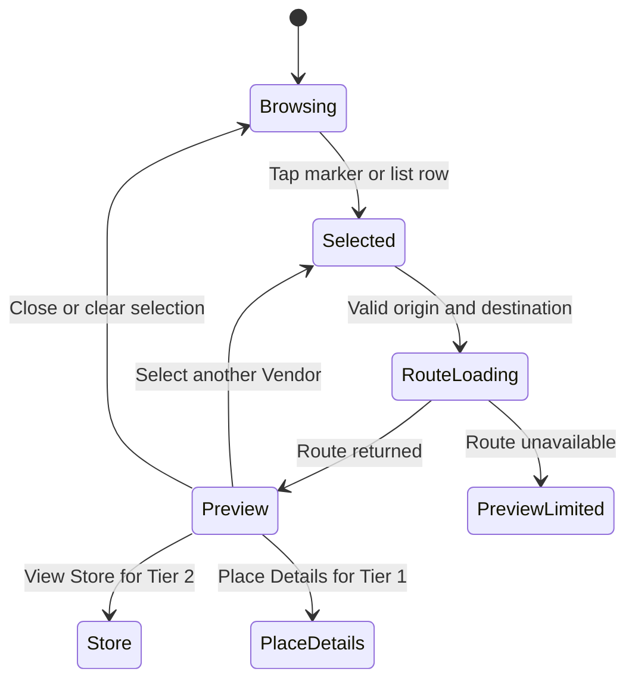
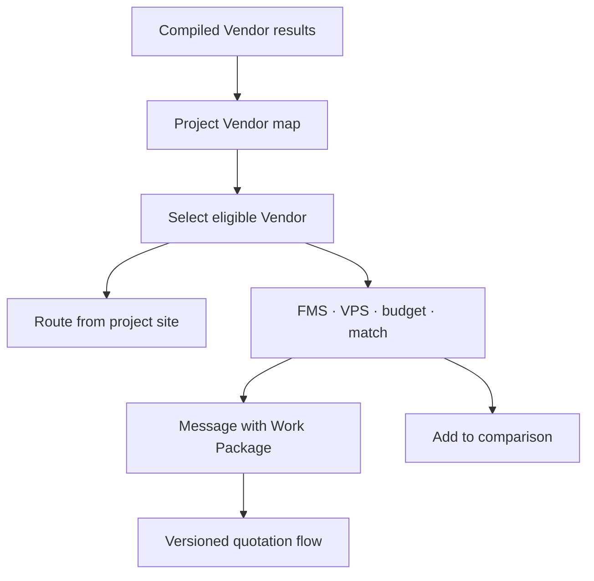

# MateryalPH UI/UX Implementation Planner

**Owner update — 2026-11-11: Vendor commission payment periods.** Replace Commission overview and Billing and payments with equal-width **Annual total commission payment** and **Monthly commission payment** panels beside Commission statements on wide screens; stack on narrow screens. Show the calendar period, one prominent net-paid amount, confirmed payments/refund breakdown, Philippine reset time and accessible calculation help. Annual history opens a separate paginated shared dialog for prior years, distinct from paid-statement History. Put current billing balances below with explicit carry-forward wording. Period rollover preserves every financial record and outstanding balance. This supersedes the 2026-11-06 panel composition only; retain consent, original rates, statement routes, payments, notices, Owner authorization and TEST safeguards.

**Owner scope decision - 2026-11-09: remove Tax Management from the capstone Admin UI.** Remove the Marketplace navigation item and the Tax Management, filing-package and taxpayer-limit screens. Legacy URLs redirect to Platform Finance without loading the removed screens. Keep commission-credit review in Commission management so removing the tax page does not remove a separate financial approval workflow. Withholding calculations, tax evidence, immutable financial/filing/audit history, permissions, reconciliation automation and API/domain services remain unchanged. This supersedes the earlier Tax Management navigation and redesign instructions below.

**Owner-requested Vendor account deletion — 2026-11-07.** Add Account Deletion as the last Owner-only Store Profile section, preserving existing section save guards. Reuse shared account-closure review, dialog, authenticator verification, status and button components. Show eligibility counts and actionable resolution links; disable confirmation until the server reports eligibility. Disclose irreversible store/team access loss, personal-profile anonymization and retained-record purposes before typed `DELETE` confirmation. Verify identity, submit once, refresh blockers on conflict, preserve retry on failure and redirect successful closure to login with a success message. Keep the current light Store Profile layout and Vacation Mode alternative.

**Owner decision — 2026-11-07: Tax Management navigation.** Add Tax Management to Marketplace using the existing Admin shell and shared tabs, filters, tables and dialogs. Its only primary views are Tax Remittance and Tax Reconciliation. Keep the monthly withholding register and filing packages in Remittance, and existing remittance reconciliation, work queue and threshold history in Reconciliation. Remove the Tax Records/Tax Adjustments UI and duplicate evidence-validation path. Platform Finance retains Finance overview, Commission management and Xendit cash revenue & remittance. Legacy links open the corresponding destination; keep period context, package review/export safeguards, existing automated validation, financial calculations and authorization unchanged. This supersedes earlier tax UI placement instructions in this planner.

**Owner request — 2026-11-07: Platform Monitoring.** Rename Integration & Job Health across Admin navigation and page references. Use a compact, white control center with locally bundled service logos and external console links for Hostinger hPanel, Duck DNS, Backblaze, Google Cloud and Xendit. Keep configuration/event health distinct from uptime and show the actual TEST commerce label. Group service status, background work and automatic recovery with shared components. Remove manual failed-job and dead-letter controls; show the recovery scheduler status, cycle limit, next eligibility time, protected-work notes and append-only activity. Retain authorized analytics re-runs, all existing routes, permissions, masked diagnostics, filters and pagination. The Admin workflow's automatic-recovery amendment governs behavior.

**Owner request — 2026-11-08: VPS provider catalog and compact layout.** Platform Monitoring's connected-service directory covers Hostinger, Duck DNS, Backblaze B2, Brevo, Cloudinary, Bouncer malware scanning, Google Cloud, Firebase and Xendit. Each card combines logo, purpose, status and an official external console link, removing the duplicate console strip. Use a full-width three-column provider grid on desktop, two columns at intermediate widths and a readable mobile list. Place integration status, queues and automatic recovery in a compact row below the directory, with natural content height and no wide empty sidebar. Retain the compact summary and expandable analytics. Only a HOSTINGER_VPS response can supply VPS health; other environments show a clearly labelled reference inventory. Keep all provider errors, TEST semantics, permissions and retry policy intact.

**Owner clarification and combination request — 2026-11-08: Preserve all details in one directory.** Merge Integrations and Connected services into one **Services & integrations** panel first in Platform Monitoring Overview. Render every server-reported entry with its complete diagnostic text, status, environment/provider labels and last-event time. Add the relevant local provider logo and official console link directly to that row, using meaningful icons for Reverb, OCR and DTI-BPS backend/reference checks. Include all nine VPS providers and catalog checks missing from the response without inferring health. Use a compact three-column desktop grid, two intermediate columns and one mobile column, with no second provider-card section. Preserve local diagnostic details while labelling provider links as VPS references on other environments. This supersedes separate-panel placement, retaining all original information and behavior.

**Owner grouping refinement — 2026-11-08.** Group the combined directory by service responsibility, then by service: Infrastructure; Payments & onboarding; Storage & media; Maps & identity; Communication; and Verification & reference. Each service has one compact logo/purpose header and one visible, labelled console link with a minimum 44px target. Keep every individual diagnostic, status, environment and timestamp directly below its service; show shared-console checks together without replacing their statuses with an aggregate badge. Reverb, OCR and DTI-BPS remain visible. Retain unknown reported adapters under Other platform services. Use dividers on the single white surface and balanced, natural-height columns (one on smaller screens, two on desktop and three on wide screens), avoiding fixed-height empty cards. These labels describe service responsibilities and do not alter user roles, authorization, local/VPS reporting boundaries or automatic recovery. This supersedes the flat-row layout and repeated per-check console links.

**Owner card-layout refinement — 2026-11-08.** Replace the directory's large enclosing white card with a plain section heading and a separate white card for every functional group. Reuse the shared card surface with 12px padding and gutters, content-height columns, one column on small screens, two at the large breakpoint and three at the extra-large breakpoint. Keep all service headers, console controls and diagnostic details expanded. Reduce service/diagnostic spacing and use the shared compact page header; opt monitoring panels into compact padding/gaps without changing other Admin panels. Tighten the environment strip, summary gaps and analytics spacing. Do not stretch cards to fill empty column space, truncate diagnostics or reduce interactive targets below 44px. This supersedes the prior single white surface and preserves every existing integration and behavior.

**Owner combined-card and left-column refinement — 2026-11-08.** Enclose all role groups in one Services & integrations card. Use a compact 18rem left column for integration status, queues/outbox and automatic recovery, with the services card in the wider right column from the extra-large breakpoint. Place always-visible Analytics and reference data immediately below this landscape, spanning both columns with a 12px gap and natural content height. Its geographic aggregation, materials snapshot and PSGC details form three columns from the large breakpoint with vertical dividers; below it they stack with horizontal dividers. The analytics section has no disclosure control and must not extend the sidebar or leave unused space alongside it. The DTI-BPS registers service includes a 44px Certified products link to https://bps.dti.gov.ph/product-certification/certified-products, opening in a new tab with an external-link icon and safe link attributes. Services remain first in the stacked mobile reading order. Inner service columns respond to the card's width rather than the viewport: one below 600px, two from 600px and three from 1000px. Give each role a distinct, subtle header tint and border accent using existing palette tokens; retain dark readable text on pale headers and white diagnostic surfaces. Colors identify functional categories, with original health-badge semantics unchanged. Keep all required details, links, 44px controls, provider-reference states and permissions. This supersedes the previous full-width directory placement and analytics sidebar placement.

**Owner clarification — 2026-11-09: separate, aligned monitoring cards.** Keep each functional service group in its own card beneath a plain Services & integrations heading. Use equal-width, equal-height grid cells at multi-column sizes so card edges align, with 12px gutters and tighter diagnostic spacing. Size the service grid by its available width: one column below 480px, two from 480px and three from 720px. Keep the three Platform health cards separate; on desktop they fill the left rail alongside the service grid, with equal-height tracks. At intermediate sizes they form a three-card row, and on mobile they stack at natural content heights. Keep Analytics and reference data full-width below the landscape. This supersedes the enclosing services card and earlier natural-height column instructions. Preserve every diagnostic, console link, status, permission, recovery rule and 44px control.

**Status:** Approved UI implementation reference
**Planner date:** 5 September 2026  
**Typeface:** Inter  
**Primary visual direction:** Professional construction marketplace; strong, modern, clean, practical, and map-first  
**Buyer platform:** Flutter mobile  
**Vendor/Admin platforms:** React 19, TypeScript, Vite 8, and token-driven Tailwind CSS  
**Design reference:** [Capstone MateryalPH Figma prototype](https://www.figma.com/design/tSnU3YwH6yynbxvfF2jVdT/Capstone_MateryalPH?node-id=0-1)  
**Design-quality workflow:** component tests and browser review

## 1. Purpose

This document turns the approved MateryalPH workflows and the existing Figma prototype into one implementation-ready UI plan. The prototype is a visual reference, not the authority for product behavior. Its recognizable orange construction identity, compact mobile layout, map-first home, radius controls, rounded controls, and bottom-sheet pattern are retained. Outdated terminology, authentication behavior, labels, scores, information architecture, and unsupported features are replaced by the approved workflows.

This planner defines:

- The source-of-truth order developers must follow.
- Design tokens shared by Flutter, Vendor React, and Admin React.
- Page inventories and navigation for all three platforms.
- Detailed Buyer Map Home and Project-Based Procurement Map behavior.
- Tier 1 Directory Supplier and Tier 2 Verified Vendor presentation.
- Motion, route-line animation, responsive behavior, accessibility, and failure states.
- Component boundaries and suggested code organization.
- Figma-to-code and design review procedures.
- Acceptance criteria that can be tested before a UI phase is accepted.

## 2. Source Priority and Conflict Resolution

When two references disagree, use this order:

1. Approved MateryalPH System, Buyer, Vendor, and Admin workflows.
2. `MateryalPH_Technical_System_Design.md` and approved Architecture Decision Records.
3. This UI/UX Implementation Planner.
4. Approved OpenAPI schemas and backend state machines.
5. The Figma prototype for visual direction and composition.
6. Existing scaffold code.

Do not preserve an outdated Figma label or flow merely because it already exists visually. Do not alter an approved business rule merely to simplify a screen. When a screen and API disagree, stop, identify the governing source, and correct the non-authoritative artifact.

## 3. Confirmed UI Decisions

The following decisions are fixed for implementation:

| Decision | Approved behavior |
| --- | --- |
| Buyer primary authenticated page | Map Home; bottom navigation is Map, Explore, Projects, Messages, Profile |
| Theme | Light-first construction/industrial visual language using the approved orange and charcoal palette |
| Typeface | Inter across all platforms |
| Map radius | `5, 10, 20, 30, 40, 50 km`; default 5 km; ask before automatic expansion |
| Dense map markers | Cluster overlapping Vendors when zoomed out; show individual labels as the map separates them |
| Tier 2 marker label | Store name plus VPS; use “New Vendor” when the public minimum sample is not met |
| Tier 1 marker label | Store name plus `Directory`; do not fabricate a VPS |
| Tier 1 rating | A Google rating may appear on Directory cards and in Place Details, labeled and attributed as Google data; Directory-only minimum rating is allowed; the separate Directory distance filter is removed (owner requests 2026-10-24) |
| Tier 2 marker interaction | Select marker, animate route, open preview sheet, then use explicit `View Store` action |
| Route origin on Map Home | Buyer-selected location; current device location only after permission and explicit selection |
| Route origin in a Project | Project site saved on the Work Package/Project |
| Route mode | Driving estimate for procurement; no live delivery GPS or fake moving-vehicle indicator |
| Project candidate scope | Eligible Tier 2 Verified Vendors only; Directory Suppliers cannot transact or quote |
| Map alternative | Every map has an equivalent synchronized list, usable without location permission |
| Repository layout | Standardize the early scaffold into `apps/*`, `services/*`, and `packages/*` before feature development |
| Web baseline | React 19 + TypeScript + Vite 8 + Tailwind, with shared semantic tokens |
| Design evaluation | Use component tests and browser review for React surfaces, plus native Flutter accessibility and visual tests |

## 4. Prototype and Repository Audit

### 4.1 What to retain from Figma

The following Figma patterns are suitable and should remain recognizable after refinement:

- Compact location selector in the Map Home header.
- Search, notification, and cart actions close to the location context.
- Horizontal radius chips above the map.
- Map-first content with recenter and layer controls.
- Draggable bottom sheet that preserves map context while showing Vendor details.
- Five-destination Buyer bottom navigation.
- Rounded buttons and chips, restrained shadows, white surfaces, and orange accents.
- Store preview containing availability, distance, estimated time, categories, trust information, and actions.
- Project Vendor comparison using budget, distance, match, quotation, and score information.

Key inspected Figma frames include:

| Figma node | Existing purpose | Implementation treatment |
| --- | --- | --- |
| `1:17996` | Home Map 5 km | Primary visual reference for Buyer Map Home |
| `1:18108` | Project Vendor Selection map | Composition reference for Project-Based Procurement Map |
| `1:18143` | Registered Vendor selection | Convert to Tier 2 Verified Vendor preview |
| `1:18341` | Unregistered Vendor selection | Convert to Tier 1 Directory Supplier Place Details |
| `1:22276` | Explore | Retain catalog/search intent; rebuild using approved filters and product data |
| `1:20170`, `1:20346`, `1:20446` | Storefront views | Consolidate into one accessible Tier 2 Store page with sections/tabs |

### 4.2 What must be replaced

| Outdated prototype element | Required replacement |
| --- | --- |
| Registered / Unregistered / Preferred | Verified Vendors / Directory Suppliers / Favorite Suppliers |
| Four-digit verification code | Six-digit email OTP |
| Phone/SMS recovery | Verified email recovery; no SMS flow |
| `Message` navigation label | `Messages` |
| Generic star rating shown as Vendor performance | Distinguish product rating, Google rating, FMS, and VPS explicitly |
| VPS for every supplier | VPS/New Vendor for Tier 2 only; `Directory` for Tier 1 |
| Weather temperature pill | Remove completely |
| Roboto on selected buttons | Inter everywhere |
| Hard-coded 375 px page behavior | Responsive safe-area layout supporting compact and large phones |
| Static image map | Google Maps SDK backed by approved Laravel endpoints and real state handling |
| Unlabeled pins | Store-name labels plus VPS/New Vendor or Directory semantics |
| Route line that can appear as live tracking | One-time route reveal for distance/ETA only |
| Misspelled labels such as “Vendor Selctecion” and “Quatation” | Approved terminology and reviewed interface copy |

### 4.3 Current repository state

The public repository is an early integration scaffold, not yet a design-system implementation:

- Buyer Flutter currently keeps prototype logic in `lib/main.dart` and `lib/main_new.dart`.
- The Buyer theme still uses an indigo seed and must be replaced by MateryalPH tokens.
- Vendor and Admin are React 19/Vite 8 JavaScript scaffolds with only root CSS/App files.
- There is no shared component/token package yet.
- Laravel is already constrained to Laravel 13, but the root README still contains an older Laravel 11 description and PHP prerequisite conflict.
- Laravel currently includes Sanctum while the approved technical design specifies Passport; resolve this through the authentication ADR and keep only one intentional primary API authentication design.

### 4.4 Approved repository migration

Perform this as a reviewed repository-foundation change before substantial UI development. Preserve Git history with `git mv`; never delete working files during the move.

| Current path | Target path |
| --- | --- |
| `Flutter_Mobile_Interface_Buyer` | `apps/buyer-mobile` |
| `React_Web_interface_Vendor` | `apps/vendor-web` |
| `React_Web_interface_Admin` | `apps/admin-web` |
| `Laravel_Main Application` | `services/api` |

Then create:

```text
packages/
├── api-contract/
├── design-tokens/
├── web-ui/
└── shared-config/
docs/
├── workflows/
├── architecture/
├── design/
└── test-plans/
```

Update imports, scripts, README commands, CI paths, Docker contexts, and editor tasks in the same change. Verify all four applications still start before committing the migration.

## 5. Experience Principles

**Owner-requested Store Performance refinement — 2026-11-06.** Place the VPS card beside a compact column containing Badges and Badge metrics. VPS uses the semicircular gauge with a star, its public publication state, VCS/OHS summary bars, calculation dates and completed-order counts. Refine this group with a larger star gauge and quiet scale marks, criterion icons beside the component bars, vector medal emblems for each badge and a count of currently earned badges. Earned, unearned and suppressed emblems must retain their explicit status labels. CRR/FRR use compact circular graphics on a fixed 0–100 scale, with exact values, windows and counted samples; unavailable values stay neutral and zero remains 0%. Keep the graphics restrained and the surfaces white. Unpublished component bars remain unfilled and retain their eligibility explanation. Below this group, place the four operational KPIs in a compact 2-by-2 grid beside Score history on desktop, followed by three aligned VCS, MQS and OHS cards. Stack the metrics and history on narrower screens. List NFR, LSR, RR, ODR and LVD inside OHS with the server's rates/counts and penalties. OHS counts eligible orders, retains its ten-order minimum and states the weekly cadence and next update. Keep the server's store health classification below the score cards in a compact strip with its as-of date, reasons and calculation help. Remove the Score history table; retain the chart's keyboard and pointer value readouts. Show badge requirements and CRR/FRR without accordion, select or ellipsis dropdown controls; retain accessible calculation dialogs. Keep scoring sample gates, windows and badge eligibility. The VCS breakdown uses the server's combined Delivery/Processing Speed criterion; never fabricate separate speed averages or infer scores from visible reviews. Keep `scores.view_store` and `orders.confirm` section grants. Supplemental KPI/health failures have an independent retry and do not hide published scores. Stack groups on narrow screens and keep their desktop alignment at wider widths.

**Owner-requested Buyer Vendor ratings and badges — 2026-11-06.** Published Tier 2 VPS displays a star followed by its score across Buyer mobile: map labels/list/selected preview, storefront, products/search, favorites and Project Vendor cards/quotations. Keep Vendor performance provenance in screen-reader text and contextual help; do not substitute product or Google ratings. Preserve server precision and New Vendor sample gates. Public earned badges reuse the medal graphics with distinct criterion icons: compact named awards on discovery and Project Vendor selection, descriptive awards in Store Profile. Most Ordered retains its category/province scope. Only current active, unsuppressed server awards are shown; unearned or suppressed portal states and private review reasons never appear to Buyers. Badge facts in Project comparisons are current response data, never written into saved commercial estimates. Preserve map tiers, sorting, radius, routes and procurement eligibility. Awards are omitted from persistent offline discovery copies and return on successful refresh.

**Owner-requested operational metric clarity — 2026-11-06.** On Store Performance, label FRR **On-time fulfillment (FRR)** and the 30-day fulfillment KPI **Order completion rate**. FRR checks the confirmed fulfillment date across eligible fulfilled orders over 90 days; the completion KPI checks completion by period end among non-cancelled orders due in 30 days. Name the remaining KPI cards **Cancelled orders**, **Orders with disputes** and **Average order decision time**. Supporting text must retain all-cause Buyer/Vendor cancellations, any dispute case status/outcome, and the first human order decision respectively. These are display names only; retain canonical metric keys, denominators, timers, exclusions, CRR/FRR definitions and score penalties. Score history remains interactive beside the desktop 2-by-2 KPI grid, above VCS/MQS/OHS, with no table or dropdown.

**Owner-requested score card refinement — 2026-11-06, updated for equal card sizes.** Keep VCS, MQS and OHS side by side on desktop with matching widths and heights, aligned top and bottom edges, and bottom-anchored source notes. Cards in the same tablet row also match heights; stacked mobile cards size to their content. Let the tallest card determine the row height without fixed heights, clipping or internal scrolling. Use a compact summary with the exact score, publication state and sample count beside a small ring with a criterion-specific icon. Rating rows retain their star/value text and gain decorative bars on the fixed five-point scale. Keep all five OHS factors, rates, event counts and penalties, with small identifying icons. Place unpublished eligibility and sample progress beside the summary content, with neutral missing rings and bars. Preserve descriptions, windows, weekly OHS cadence, calculation help, sample gates and server publication flags. Stack the cards on narrow screens. The centered ring used in Ratings & Reviews retains its existing layout.

**Owner-requested review card headings — 2026-11-05.** Name the Store ratings overview card **Community rating (VCS)** and the Product reviews overview card **Material quality (MQS)**. This is a heading-only change; retain the existing criterion values, aggregation scope and explanatory notes.

**Owner-requested reviewed product context — 2026-11-05.** Vendor Product Review details show the current listing's ready, clean photo beside its purchased name and variant, with the standard thumbnail fallback when unavailable. Add View product analytics for the exact reviewed listing only when the current member has `catalog.manage`. Retain `reviews.view`, current catalog-file delivery authorization and immutable order snapshots. Returning from a review opened in Product Analytics retains its product, period and review page.

**Owner-requested review identity and Buyer Profile rating — 2026-11-05; Profile placement updated 2026-11-09.** Vendor Ratings & Reviews keeps Store ratings and Product reviews; remove Your Buyer ratings. Authorized completed-order Buyer-rating actions remain. Buyer mobile Profile shows the server-calculated CCS as one star and score beside the name, with a dash while unpublished and no rating card. A check beside the name means verified email ownership only. Show the authenticated owner's full email with wrapping. Place the Buyer rating menu row immediately below Account Setting; its separate page shows the score, eligible count and expandable, paginated Ratings from stores, initially expanded. Below five eligible completed transactions in 90 days show Building your rating and the eligible count, without a numeric score. My Reviews continues to cover the Buyer's submitted feedback. Buyer-authored reviews show the full profile name and available photo; remove anonymous display choices. Resolve legacy identities at read time without rewriting review snapshots or immutable history. Preserve blind reveal, moderation/dispute/exclusion gates, report actions and private-photo authorization.

**Owner-requested supplier-tab explanations — 2026-11-09.** The shared Map supplier controls show one short explanation directly beneath the selected tab. Verified means verified MateryalPH stores with in-app browsing, messaging and orders; Directory means Google-listed informational suppliers contacted outside MateryalPH; Favorites means suppliers saved by the Buyer from either tier. Keep provider attribution, existing tab visibility and discovery behavior.

**Owner decision — 2026-11-04: direct downloads.** Across Buyer, Vendor and Admin, an export button or icon starts generation and downloads the requested file when ready. Do not ask for a reason or require separate Generate and Download clicks. When several document types are available, provide a named action for each. Record document context automatically for the existing audit contract. Keep permission checks, required Admin identity verification, private storage, expiry and checksum validation. Native save-location controls remain platform-managed.

**Owner-requested invoice workspace — 2026-11-04.** Preserve the white cards, orange accents and split invoice-list/detail composition. Invoice details show parties, invoice date, accepted material/price/quantity breakdown, totals and the attached copy, with a Send action and no Edit/Hold header actions. Upload opens a responsive modal with reusable store business defaults above document-specific fields and file selection. New dates default to today in Asia/Manila. A saved upload has a checkmark and can be reviewed or replaced before Send. Sending locks that version; a Buyer return/correction allows a linked new version. Preset settings remain available after Send. On Buyer mobile, show the attachment (image preview or secure PDF Open action) above invoice details and accepted-order context, hide Request a copy after a sales invoice is sent, and retain correction/history actions. Keep private drafts and accepted financial values separate, and preserve all server authorization, TEST labels and failure/retry states.

**Owner-requested invoice corrections — 2026-11-09.** Requests excludes sent and downloaded copies. Rename Amount mismatches to Mismatches and include Buyer returns/correction requests even when their totals match. Show one latest invoice per affected order, preserving every sent version in Uploaded/history. Prepare corrected invoice opens the existing shared upload dialog for editable document information and an optional replacement file; Review corrected invoice reopens a saved private correction, followed by explicit Send. Place this action near the top of the detail panel and preserve the selected invoice while its list refreshes. Explain-only controls no longer serve as the correction action; an explained difference remains actionable. Correction numbers are new, their original version link is fixed, and all previous files, accepted values, TEST labels, authorization and send safeguards remain intact.

**Owner clarification and Purchase Order update — 2026-11-04.** The Purchase Order is automatically prepared from accepted terms and reused on download. Its PDF groups Vendor/Buyer details in two columns, includes supplied billing details, Buyer email/mobile, Vendor public contacts, payment/fulfillment methods and accepted item/amount sections. Missing fields say not provided. Remove the separate payment-confirmation action/row across all clients. The MateryalPH document row shows Download PDF when ready, Preparing PDF while queued, and an acceptance dependency or failure otherwise. Keep Not a tax invoice and compact sample/BIR footer labels, without the large notice strip. Existing authorization and immutable commercial retention apply; only ad hoc report copies use the 24-hour expiry.

**Owner-requested order PDF layout — 2026-11-04.** Use an A4 portrait layout with a compact brand/reference header, party/contact details, payment/fulfillment methods, status and Manila issue date, a repeating material/quantity/unit/price table and aligned accepted totals. Do not show the large sample notice strip; use a compact footer label with the order reference and page count. Put the source hash and capture dates in secondary record-integrity information. Preserve the source values and all earlier issued files when publishing a new layout rendition. Historical payment-document presentation support does not expose a new payment-confirmation action.

**Owner-requested document row update — 2026-11-05.** Remove the Not a tax invoice badge from the web MateryalPH documents row. Show the document title and its download action or availability status. Retain the document classification and PDF footer labels.

**Owner-requested invoice Buyer name — 2026-11-05.** In No copy yet, show the Buyer name beneath the order reference, including unrequested copies. In invoice details without billing information, show the order Buyer name with a clear missing-billing-details message. Supplied billing information takes priority. Preserve sent document snapshots and existing order-scoped invoice authorization.

1. **Map first, decision second.** Geography gives context; the bottom sheet/list supplies the facts required to decide.
2. **Progressive disclosure.** Show name, tier, score, distance, ETA, and primary action first. Put detailed ratings, categories, terms, and provenance behind the expanded sheet.
3. **Trust must be explainable.** `Verified Vendor`, `Directory`, `VPS`, `FMS`, `Google rating`, `PS/ICC`, and `New Vendor` must never look interchangeable.
4. **One obvious next action.** A screen may offer secondary actions, but only one filled primary button should dominate a decision area.
5. **No invented certainty.** When route, stock, price, score, or provider data is unavailable, say so and offer a safe retry or alternative.
6. **Industrial, not decorative.** Use strong type, measured spacing, clear dividers, purposeful icons, and limited ornament.
7. **Motion explains change.** Animation connects a selected pin to its route and details; it never delays work or pretends to be live tracking.
8. **Accessibility is structural.** Map alternatives, visible labels, focus order, semantics, contrast, and reduced motion are part of the component contract.

## 6. Design System

### 6.1 Color tokens

The user's approved palette remains the brand foundation. The deeper orange action token is added so white button text meets accessibility contrast while `#F97316` remains visibly central to the identity.

| Token | Value | Use |
| --- | --- | --- |
| `brand.orange.50` | `#FFF7ED` | Selected surface, subtle callout background |
| `brand.orange.100` | `#FFEDD5` | Hover/selected soft background |
| `brand.orange.300` | `#FDBA74` | Decorative accent and route halo |
| `brand.orange.500` | `#F97316` | Primary brand accent, active nav icon, selected outline, price highlight |
| `brand.orange.600` | `#EA580C` | Strong icon/outline and focus-adjacent accents |
| `action.primary` | `#C2410C` | Accessible filled primary button with white text |
| `action.primary.pressed` | `#9A3412` | Pressed state |
| `text.strong` | `#1F2937` | Headings and primary body text |
| `text.secondary` | `#475569` | Supporting text on white/off-white only |
| `border.default` | `#E5E7EB` | Dividers, inputs, cards, table lines |
| `surface.canvas` | `#F8FAFC` | Page/app background |
| `surface.primary` | `#FFFFFF` | Cards, sheets, navigation, dialogs |
| `status.warning` | `#FBBF24` | Warning icon/background with charcoal text |
| `status.success` | `#16A34A` | Success status with icon/text label |
| `status.error` | `#DC2626` | Error/destructive state with text and icon |
| `status.info` | `#2563EB` | Informational status and route alternative |
| `focus.ring` | `#2563EB` | Visible keyboard focus independent of brand state |
| `overlay.scrim` | `rgba(15, 23, 42, 0.42)` | Modal/sheet background scrim |

Rules:

- Do not use white normal-size text on `brand.orange.500`; use charcoal text, an outlined treatment, or `action.primary` for a filled white-label button.
- Never communicate a tier, score, stock condition, budget status, or error using color alone.
- Do not use low-contrast gray copy over orange/yellow/color-filled surfaces.
- Map pins combine color, shape/icon, and text label.
- High-contrast mode must preserve outlines, text, and selected state when map colors change.

**Ranking preference visualization (owner request, 2026-10-18).** Both Buyer ranking editors place a live Ranking Influence panel above the priority controls: a segmented bar, a descending list of labeled influence percentages and bars, and the most influential factor (including ties and an explicit all-zero state). The `ranking-*` color tokens identify factors consistently as their order changes; labels and numbers carry the same meaning without color. Percentages are a local, rounded preview of `weight / sum of weights`, never replacements for saved slider values. Priority cards keep independent 0–100 sliders, descriptions, increment/decrement controls and low/high labels. Reset sits beside Adjust priorities; Save remains a persistent primary action. The controls and visualization reflow with large text and a constrained tablet width.

### 6.2 Map semantics

| Entity/state | Marker treatment | Label |
| --- | --- | --- |
| Tier 2 Verified Vendor | Orange teardrop with white verified check | Store name + `VPS 4.7` or `New Vendor` |
| Tier 1 Directory Supplier | White teardrop, steel-gray outline and building glyph | Store name + `Directory` |
| Favorite Supplier (either tier) | That tier's teardrop plus gold ring and path-drawn top-right star badge | Same score or `Directory` label |
| Buyer-selected location | Blue location dot with white border | `Your selected location` in accessibility label |
| Project site | Charcoal/orange hard-hat or project marker | Project/Work Package site name |
| Selected Vendor | 2 px charcoal outer ring, raised label, increased z-order | Full untruncated label where space permits |
| Cluster | Segmented orange/gray ring with total count and a gold star chip showing favorite count | Accessible count, e.g. `12 suppliers in this area` |

Do not label a Google rating as VPS. Do not label a Tier 1 supplier as verified. A Tier 2 Vendor below the required score sample shows `New Vendor`, not an artificial neutral rating.

### 6.3 Typography

Use Inter through bundled/licensed app assets or a controlled web-font strategy with fallback metrics. Do not fetch fonts at runtime from an unapproved third party.

| Style | Size/line height | Weight | Use |
| --- | --- | ---: | --- |
| Display | 32/40 | 700 | Public landing hero only |
| H1 | 28/36 | 700 | Desktop page title; large mobile title |
| H2 | 22/30 | 700 | Section title, expanded sheet title |
| H3 | 18/26 | 600 | Card/section heading |
| Body large | 16/24 | 400 | Primary form and detail copy |
| Body | 14/21 | 400 | Standard interface copy |
| Body strong | 14/21 | 600 | Emphasis, totals, important labels |
| Label | 12/16 | 600 | Chips, metadata, field labels |
| Caption | 11/16 | 500 | Secondary metadata; never critical content alone |

Use sentence case. Avoid all caps except short stable status codes inside accessible status components. Support system text scaling without clipping or hiding actions.

### 6.4 Spacing, sizing, radius, and elevation

- Base spacing unit: 4 px.
- Common spacing: 4, 8, 12, 16, 20, 24, 32, 40, 48, and 64 px.
- Mobile page gutters: 16 px; allow 20–24 px on wider phones.
- Desktop content: 24–32 px gutters; readable maximum content width 1440 px.
- Minimum interactive target: 44×44 px; never below WCAG's 24×24 CSS-pixel minimum.
- Input/button height: 48 px mobile, 40–44 px dense desktop tables, unless content requires more.
- Radius: 8 px controls, 12 px cards/inputs, 16 px sheets, pill only for chips/status/segmented controls.
- Avoid nested cards. Use one surface, spacing, dividers, and section headings before adding another bordered container.
- Elevation level 1: subtle border plus `0 1px 2px rgba(15,23,42,.08)`.
- Elevation level 2: floating controls/sheets using `0 8px 24px rgba(15,23,42,.14)`.
- Selected marker label may use elevation level 2; routine cards stay level 1 or flat.

### 6.5 Icons and imagery

- Use one consistent outlined/filled icon family with verified licensing.
- Icons must have accessible names when actionable and be hidden from assistive technology when decorative.
- Store/logo images use deterministic aspect ratios and meaningful alternatives.
- Product images use 4:3 or 1:1 containers with `BoxFit.cover`/`object-cover` and a neutral fallback.
- Never recreate Figma-exported brand artwork from memory. Export approved assets once, optimize them, commit non-sensitive assets, and record their source.
- Google map/provider logos and attribution must remain visible and unobstructed.

## 7. Responsive Layout System

### 7.1 Buyer mobile

| Width | Behavior |
| ---: | --- |
| `<360 px` | Compact labels, horizontally scrollable radius chips, full-width sheets, no clipped actions |
| `360–479 px` | Primary phone layout based on the Figma 375 px composition |
| `480–767 px` | Wider mobile; allow two-column product grids only where scanning improves |
| `≥768 px` Flutter tablet | Navigation rail or centered constrained content; map/details may use split view |

Use safe areas for camera notches, system bars, gesture indicators, and keyboard insets. Do not encode iPhone-specific status bars into app content.

### 7.2 Vendor and Admin web

| Breakpoint | Navigation/content behavior |
| --- | --- |
| `<640 px` | Drawer navigation, one-column forms, stacked actions, horizontal table alternatives |
| `640–1023 px` | Compact sidebar or drawer; two-column summaries when useful |
| `1024–1439 px` | Persistent sidebar; main content grid; sticky page actions where safe |
| `≥1440 px` | Constrained readable content with analytics expansion; do not stretch forms edge to edge |

Tables must reflow into labeled row cards or support deliberate horizontal scrolling with frozen identifiers. Critical actions cannot disappear at smaller widths.

## 8. Buyer Navigation and Page Inventory

### 8.1 Global shell

The five destinations are fixed:

| Destination | Purpose | Preserved state |
| --- | --- | --- |
| Map | Nearby supplier discovery and spatial decisions | Selected location, radius, filters, camera, selected Vendor when valid |
| Explore | Item-Based catalog/search and ranking | Query, filters, sort/tune weights, scroll position |
| Projects | Project and Work Package management | Active project, work package, vendor comparison state |
| Messages | Store conversations and quotation negotiation | Selected conversation and draft text per safe policy |
| Profile | Account, locations, preferences, reports, privacy, and security | Active subsection where appropriate |

Use state restoration carefully: never restore a stale quotation acceptance, expired payment form, TOTP value, password, OTP, or sensitive evidence upload.

**Buyer account follow-up — 2026-11-09.** Label the Profile received-rating row and its destination page Your rating, retaining placement immediately below Account Setting. Edit Account Details keeps phone Add/Change within Contact details. Reuse the country selector/mobile-number field, prefill an existing number, and show Save phone number and Cancel while editing. Validate before sending, preserve entered input after failure, and show a local success/error notice. Saving a phone keeps unsaved personal-information fields. Retain the authenticated-owner scope, profile-version check, audit event, email/security flow and private contact rules.

### 8.2 Buyer page inventory

| Area | Required pages/states |
| --- | --- |
| Launch | Splash, service maintenance, forced upgrade only when necessary |
| Onboarding | Three concise value slides, Skip, Continue, accessibility labels |
| Authentication | Sign up, six-digit email verification, sign in, Google sign in, forgot/reset password, step-up verification, session-expired |
| Location | Permission education, device location, search address, choose on map, saved locations, project site, manual fallback |
| Map | Map Home, map filters, synchronized supplier list, Tier 1 Place Details, Tier 2 Vendor Preview, route failure |
| Explore | Search home, suggestions/recent search, results, filters, ranking preferences, product details, Vendor store |
| Cart/checkout | Cart, multi-Vendor grouping, delivery/payment selection, fee breakdown, vendor-confirmation state, payment expiry/result |
| Projects | Project list, create/edit, phase/work package, BOM/BOQ editor, compiled results, comparison, Project Vendor Map, notes |
| Messaging | Conversation list, conversation detail, staff identity, attached Work Package, quotation version/change summary, counter-offer |
| Orders | Order list, order detail, timeline, proof, cancellation, refund status, issue/dispute, review |
| Profile | Personal details, saved locations, favorites, ranking preferences, notification settings, sessions/security, reports, account deletion |

Every page implements loading, empty, populated, validation, disabled, permission-denied, offline/provider-failure, retry, and success states where applicable.

## 9. Detailed Buyer Map Home Specification

### 9.1 Layout

The authenticated Map Home is the Buyer's home page.

1. **Top safe-area header:** `Location` label, selected location name, dropdown chevron, Search, Notifications with unread count, and Cart with item count.
2. **Radius/filter bar:** Tune button followed by horizontally scrollable 5/10/20/30/40/50 km chips. The selected radius uses brand accent plus text/shape, not color alone. The filter sheet starts with its own Favorite Suppliers only section, which applies to both tiers (owner request 2026-10-25), then groups Supplier type and Material category beneath the Verified Vendors toggle, then places Minimum Google rating beneath the Directory Suppliers toggle. Only Supplier type and Material category hide Directory Suppliers. Use flat sections, a clear divider, consistent child indentation and a scrolling options area with Reset/Apply kept visible.
3. **Map viewport:** selected-location marker, radius boundary, clustered Vendor markers, selected route, provider attribution.
4. **Floating controls:** recenter, layers/legend, and `List view`. Place controls away from Google attribution and sheet drag area.
5. **Context sheet:** collapsed handle and `Suppliers near you` summary with a reusable compact toolbar when no Vendor is selected: rounded accent-outline store-name search with trailing magnifier, wrapping Verified/Directory/Favorites chips, then inline Distance/Rating controls with an active underline and direction arrow. Tapping the active sort reverses it; switching modes starts nearest distance or highest rating. Controls retain 44 px targets and wrap at large text sizes. Selected Vendor preview appears when a pin/list row is selected.
6. **Bottom navigation:** Map, Explore, Projects, Messages, Profile with text labels at all times.

The sheet uses three snap positions:

- Peek: title/count or selected Vendor name and main score.
- Half: decision essentials and primary action.
- Expanded: full Place/Vendor detail with scrollable content.

### 9.2 Marker rendering and clustering

- Discover suppliers through the API within the selected radius and authorized filters. Keep the complete eligible result set in the synchronized list; create native markers/labels only for the current viewport plus a 192 logical-pixel buffer, retaining the selection even outside that area. Panning brings suppliers into view without another provider search or a fixed marker-count cap.
- At low zoom, cluster spatially overlapping results. Owner tuning 2026-10-24 uses greedy screen-distance clustering: radius 64 logical pixels below zoom 11, sliding linearly to 36 at zoom 13 (held through 13.49), and individual pins from 13.5. Re-cluster on each half-zoom band during camera movement, throttled to 60 ms, plus a 60 ms idle debounce. Coalesce result pages for 100 ms. Cluster taps fit member bounds; members within about 30 m, or clusters at maximum zoom, fan out in a small circle. Subject to device/performance validation.
- A cluster announces its total and tier composition. Selecting it zooms to bounds or expands the cluster; it does not choose a Vendor arbitrarily.
- When individual markers do not collide, display store name plus score/tier label.
- On label collision, preserve the selected label, then nearest/highest-ranked visible labels, while keeping all suppliers discoverable through the synchronized list. This is a rendering rule, not a ranking change.
- Marker virtualization must prevent rebuilding every marker on minor camera movement. Use spatial indexes for greedy clustering and label collision checks while preserving their result order and priority. Coalesce overlapping renders, skip unchanged marker data after discovery revalidation, and skip unchanged viewport candidates/settings. Read native viewport bounds during panning at most every 120 ms (60 ms for a changed half-zoom band), with the existing 60 ms idle debounce. Keep the bitmap LRU bounded.
- Do not request a route for every visible marker. Request a route only for the selected Vendor.

### 9.3 Vendor selection sequence



On selection:

1. Give the marker selected semantics, raise its z-index, reveal its complete label, and synchronize the list row.
2. Move the camera only enough to keep the marker, route, and preview visible. Do not disorient the Buyer with a full reset.
3. Start the route request from the active selected location to the Vendor.
4. Show a route skeleton in the details area; do not display guessed travel time.
5. When the route arrives, reveal the polyline from origin to destination and update distance/ETA together.
6. Open the preview sheet. Announce the selected Vendor and route result to assistive technology.
7. If the route fails, keep the Vendor selected, show straight-line proximity only when available, label ETA `Unavailable`, and offer Retry.

### 9.4 Route-line motion

- Camera adjustment: 320–450 ms using ease-out cubic.
- Marker selection: 160 ms scale/outline transition; no bounce.
- Route reveal: 600–900 ms stroke reveal following the returned polyline.
- Sheet entrance: 220–280 ms ease-out.
- Use directional chevrons or a subtle static direction treatment after reveal.
- Do not animate a vehicle along the route because MateryalPH does not provide live tracking.
- With Reduce Motion enabled, skip the stroke animation and camera tween; render the final route and sheet immediately.
- Cancel the previous request/animation when another Vendor is selected. Never let a stale route overwrite the current selection.

### 9.5 Tier 2 Verified Vendor preview

The initial/half sheet shows:

- Store logo, store name, Verified Vendor badge, Favorite toggle.
- `VPS 4.7` with an info action, or `New Vendor — Building Track Record`.
- Distance and driving ETA with timestamp such as `Estimated now`.
- Open/closed status based on approved public store hours.
- Fulfillment methods: Pickup, Vendor Delivery, or Both.
- High-level categories and service radius.
- Primary `View Store`; secondary `Message`.

The expanded sheet may add score components, public badges, approved contact information, store address, hours, policies, and report action. It must not reveal exact inventory quantities, staff personal contact details, payout information, or private documents.

### 9.6 Tier 1 Directory Supplier Place Details

Tier 1 remains information-only. The sheet may display only provider-returned and policy-permitted fields:

- Name and `Directory Supplier` label.
- Google attribution close to provider data.
- Formatted address.
- Public phone number, website, and opening hours when returned.
- Google rating and rating count may appear on Directory cards and in Place Details, always labeled `Google rating` with Google attribution. Minimum Google rating applies only to Directory Suppliers. The separate Directory distance filter is removed by owner request on 2026-10-24; the shared selected radius remains the boundary. Verified Vendor eligibility and VPS are unchanged.
- Distance and driving ETA from the selected origin.
- `Call`, `Open in Google Maps`, `Website`, or `Share` when available.
- A Favorite (bookmark) toggle. By owner request on 2026-10-25 a Directory Supplier may be saved as a Favorite Supplier; the Favorite stores only the Google Place ID, never provider content, and keeps the place informational.

Both previews share one layout: header (image, name, Favorite, Close) with tier/score badges on a full-width row beneath, aligned status lines (open status, route), one filled primary action with a secondary icon action, then labelled groups (`Categories`, `Store details`; or `Opening hours`, `Contact`) in flat bordered cards, with notices and attribution as footnotes.

Do not show Add to Cart, Buy, Message in MateryalPH, VPS, Verified Vendor, inventory, MateryalPH reviews, or a MateryalPH Storefront action. Missing provider fields are omitted rather than shown as misleading placeholders.

### 9.7 Map Home states

| State | Required UI |
| --- | --- |
| First entry | Brief location explanation; choose device location or enter manually |
| Permission denied | Manual location search and map-pin placement; no blocking modal loop |
| Loading suppliers | Map remains interactive; skeleton in list/sheet; progress semantics |
| No suppliers in 5 km | Explain result and ask before expanding to the next radius |
| Offline | Cached map/list context if permitted, offline banner, no stale ETA presented as current |
| Places unavailable | Keep verified MateryalPH Vendors usable; explain Directory data is temporarily unavailable |
| Routes unavailable | Keep details; show ETA unavailable and safe retry |
| Location changed | Clear stale route/selection when invalid; refresh using explicit visible state |
| Too many results | Cluster and paginate/list; never silently omit based on client limits |

## 10. Explore Home and Item-Based Discovery

Explore complements, rather than duplicates, Map Home.

- Header: selected location, search, notifications, cart.
- Search prompt: `Find construction materials near your site`.
- Quick categories: Cement, Steel, Lumber, Electrical, Plumbing, Roofing, Finishing, Tools/Hardware, and configured categories.
- Recent searches and saved/favorite suppliers are optional personalized sections with clear management actions.
- Results may use a responsive grid on larger devices and a dense accessible list on compact devices.
- Product cards show product image, canonical material/variant, price/unit, product rating or sample message, distance, availability label, Vendor name/tier, and one relevant action.
- `Best Price` appears only when the defined comparable-product rule is satisfied.
- Tune control exposes Item-Based personalized SRS weights, requires 100%, and offers Reset to Default.
- Filter sheet supports category, verified/directory/favorite supplier, stock availability, price range, fulfillment, distance, product compliance, and rating eligibility without hiding active filters.
- Selecting `View on Map` focuses the same supplier/product context on Map Home without losing the search.

## 11. Detailed Project-Based Procurement Map

The Work Package requirements page shows Reactivate, Edit and Delete below each saved version without requiring its contents to be expanded. Actions wrap on compact screens. Label the current version and explain unavailable actions: replacement is required before deletion, selection requires order cancellation before revision, and closed Projects are read-only. Confirm reactivation, editing into a new current Draft and removal from visible history; explain invalidation and retained originals before proceeding (owner decision 2026-10-15).

### 11.1 Entry and purpose

Open this map from a selected Project and Work Package after the system compiles eligible Vendor results. Only eligible Tier 2 Verified Vendors appear because Directory Suppliers cannot submit quotations or transact.

The screen answers four questions:

1. Which eligible Vendors are near the project site?
2. How strong is each Vendor's platform performance?
3. How well does each Vendor match the Work Package and budget?
4. What can the Buyer do next: review, note, message, compare, or select?

### 11.2 Layout

1. **Context header:** Back, Project name, Work Package name, result count, overflow/help.
2. **Context summary strip:** Phase budget, package line count, active radius, and personalized FMS indicator.
3. **Radius/filter row:** Same 5–50 km component and tune/filter entry as Map Home.
4. **Map:** Project site origin, radius boundary, eligible Vendor clusters/labels, selected route.
5. **Map/list switch:** Synchronized candidate list with identical selection.
6. **Candidate sheet:** score/budget/match summary and inquiry actions.

### 11.3 Marker and selection content

Each individual marker shows store name plus VPS/New Vendor. The selected candidate sheet shows:

- Store name, Verified Vendor badge, VPS/New Vendor, public performance badges.
- Driving distance and ETA from the Project site.
- FMS score and a `How this was calculated` expansion.
- Material-match completeness: matched, missing, and proposed-substitution counts.
- Estimated/quoted materials total, delivery, processing fee when applicable, and total.
- Phase budget result: Under Budget, Within Budget, or Over Budget with exact difference.
- Inventory freshness/confirmation status without exact private quantities.
- Fulfillment options and estimated trip/vehicle summary when available.
- Quotation status/deadline when an inquiry already exists.
- Primary contextual action: `Message Vendor`, `Review Latest Quote`, or `Compare`.
- Secondary actions: `View Store`, `Add Note`, `Favorite`.

`Add Note` is informational only and explicitly says `No Vendor response required`. `Message Vendor` starts or resumes an inquiry and auto-attaches the locked Buyer Work Package reference plus a Vendor-editable duplicate. The attachment explanation must be visible before the first message is sent.

### 11.4 Project map flow



The map and list use the same candidate state. Selecting a candidate in either surface updates both. Accepting one Vendor's latest quotation expires other open inquiries for that Work Package according to the workflow but preserves their history.

### 11.5 Project map errors and edge cases

- If the Project site is missing, block route/nearby ranking and lead the Buyer to set the site.
- If a candidate becomes ineligible, show the reason and remove quote/select actions without erasing history.
- If the Vendor changes the quotation, mark the earlier version superseded and require review of the latest change summary.
- If stock revalidation fails at acceptance, do not send the Buyer to payment; show affected lines and return to inquiry.
- If the budget is absent, show `No phase budget set`; do not infer Under/Over.
- If routes fail, FMS may use the approved fallback/last computed distance rule only when the backend explicitly marks provenance and freshness.
- If a Work Package has many candidates, clustering and list pagination must not change ranking order silently.

## 12. Storefront, Product, and Vendor Identity

### 12.1 Tier 2 Store page

Consolidate the prototype's separate storefront experiments into one route with these sections:

- Store header: logo, name, verification, favorite, location/distance, fulfillment, public contact.
- Overview: description, hours, service area, supplier classifications, performance summary.
- Products: searchable/filterable published listings only.
- Reviews: eligible MateryalPH reviews and public score sample explanations.
- Compliance: approved public PS/ICC evidence/status for regulated listings; do not expose private documents.
- Policies: fulfillment, cancellation, NRPC explanation, and store-provided public terms that do not override platform rules.

Use sticky tabs only when they remain accessible with text scaling. The primary action changes with context: Browse Products, Message Store, or Return to Work Package.

### 12.2 Staff identity in messaging

Conversation headers display store logo/name, Verified Vendor badge where applicable, staff avatar/display name/role, and `You are chatting with…` or `Handled by…`. Never display staff email, login identifier, or personal phone. A transfer creates a visible system message and accessible announcement.

## 13. Vendor Public Landing Page

The Phase 1 Vendor landing page should use the same brand system without copying the mobile layout directly.

### Recommended section order

1. Sticky header: MateryalPH logo, How It Works, Features, Trust & Compliance, Sign In, `Register Your Store`.
2. Hero: strong procurement/vendor value statement, two actions, product/map visual using real UI composition rather than a generic dashboard collage.
3. Proof of workflow: Discover locally → Verify products/store → Quote/confirm → Fulfill and get paid.
4. Vendor benefits: local visibility, inventory/listings, Item/Project orders, structured quotation, performance insights.
5. Trust/compliance: Vendor verification, PS/ICC handling, Xendit onboarding, and the approved 2% Vendor-paid commission under FIN-03 with separate processor-fee disclosure.
6. Role/team operations: Owner and approved staff roles.
7. FAQ: eligibility, onboarding, payments, fees, listings, refunds, and support.
8. Final CTA and complete footer with policies/contact/accessibility statement.

Avoid unsupported marketing claims such as guaranteed sales, instant activation, escrow protection, real-time delivery tracking, automatic compliance approval, or no fees. Use real product language from the workflows.

## 14. Vendor Portal UI Planner

**Owner presentation update — 2026-11-07:** Rename Vendor Net sales to **Earnings** throughout Dashboard and Finance labels, chart legends, breakdowns and calculation help. Place Earnings first on the left with the orange accent, followed by Gross sales, using the shared summary component. Preserve the figures, date filters and access rules.

**Owner decision — 2026-11-07: automatic commission billing and credits.** Monthly commission bills are created and issued automatically at 00:05 Asia/Manila on the first for each Vendor with billable completed orders. Admin does not approve each Vendor bill. Preserve the original rate, deterministic centavo calculations, dispute holds, immutable invoice snapshot, one Owner notification/email and due date (the fifteenth, or twelve days after a late issue). Missing monthly bills and existing drafts are recovered automatically every five minutes. Executed dispute money awards apply their cumulative VAT-exclusive materials credit automatically, immediately for earned fees or on completion for estimates; cancelled estimates earn nothing. Each system adjustment references one authoritative executed remedy, uses a SYSTEM actor and posts the existing balanced reversal, original-statement reduction and original-fee-capture refund where required. Duplicate execution/recovery cannot issue, credit or notify twice. Existing manually prepared corrections retain independent approval; tax adjustments retain their existing review. This supersedes the older routine statement and dispute-credit approval requirements only. Admin Commission management combines read-only Vendor bills and Vendor commission payments in one view; legacy Transactions links still open that view. Payment status/date filters and matching private PDF/CSV exports include successful platform-fee captures only, never Buyer order payments. No automatic debit, withdrawal, real funds or BIR issuance is introduced.

**Owner-requested Admin Platform Finance alignment — 2026-11-07.** Admin Finance reuses Vendor Finance's compact summary, visible calculation rows, chart styles, provider card and responsive ledgers. Keep Finance overview, Commission management, Transactions, Xendit cash revenue & remittance, Tax remittance and Reconciliation in one primary tab row. Commission management pairs a statement work area and credit approvals with the rate and billing context. Draft rows offer Edit e-invoice and Approve and issue; the editor previews fixed amounts and editable heading/message, and saving keeps the draft unsent. Issued copies have no editing control. Transactions contains successful Vendor commission payments with paid date, actual evidence origin, refunded amount and retained collections; legacy payment links open it. The Xendit summary retains its date control through loading/errors and uses recorded platform commission collections, without claiming a live balance or bank remittance. Marketplace records remain in a supporting overview disclosure. Preserve independent credit approval, billing rules, authorization and immutable snapshots.

**Admin overview reference correction — 2026-11-07.** Follow the supplied Vendor Finance screenshot's composition: one overview header with dates, three summary cards, a commission activity chart beside visible calculations, a second row pairing commission adjustments with deductions/tax records, then full-width Commission billing and Online payment channels panels. Use the existing shared Finance rows so the paired panels align on wide screens and stack on narrower screens. Put finance actions in a compact bottom strip. Charts retain a visible View as table disclosure. Keep Admin platform earnings, Vendor tax evidence and marketplace payment records distinct, and never substitute Vendor sales or invent comparison percentages for platform figures.

**Owner-requested order identity and location map — 2026-11-06.** The order drawer and full Order information show the Buyer's current private profile photo with initials when unavailable. Photo reads follow current order-view authorization, including Self-Pickup and closed orders; the existing delivery-only phone/contact scope is unchanged. Replace the text-only Pickup/Delivery location area with the shared map and readable address alternative. Self-Pickup pins the store only; Site Delivery pins the registered store and the order's saved actual vehicle endpoint, with an on-demand Google driving estimate/polyline and navigation link. Keep intended site and heavy-vehicle alternate drop-off distinct, preserve addresses and retry during provider failures, and never infer device location or live delivery GPS. Historical pickup addresses without matching coordinates retain their address/navigation fallback.

**Owner-requested Buyer order notes — 2026-11-11.** Place a compact, shared **Notes from Vendor** section near the top of Buyer Order Details when recorded milestone notes exist. Show each note with its milestone and Philippine date/time, preserve line breaks and wrap long text. Omit blank notes and empty sections; retain notes after closure. Handover notes appear once in this section while proof stays attached to its milestone. Use only the authorized order response and preserve order states, commercial terms and immutable history.

**Owner-requested commission statements — 2026-11-06.** Commission monitoring groups Commission overview, Billing and payments, and a compact published-statements panel in one desktop row. Statements retain server pagination; a History button opens fully paid statements in the shared FormDialog, with issue-date filters and matching exports inside it. The main panel shows the other published states without a date control. History links preserve modal/date/page return context; legacy Transactions statement links preserve dates/page when redirected. Remove the statement tab from Transactions. Statement details use compact white summary cells, a signed order/credit table with original rates, payment history, one clear TEST context and a payment rail only while an amount is payable. Preserve payment validation, attempts, authorization, direct PDF export, statuses and return context. One information icon explains Billing and payments. Statement issue emails attach a private immutable SAMPLE/TEST platform service invoice; drafts never send it, and the document must not imply official tax or BIR issuance.

**Owner-requested Finance navigation and compact overview — 2026-11-05, updated 2026-11-06.** Use one primary tab row for Finance overview, Commission monitoring, Transactions and Xendit cash revenue & remittance. The Xendit cash revenue & remittance page and tab replace the former Balance, Xendit online payout and Gross-remittance threshold labels; retain its annual threshold details, withholding rules and `section=threshold` URL. Keep online payment channels in Finance overview; place Xendit connection, the Xendit cash revenue summary and Payment breakdown in Xendit cash revenue & remittance. Former `section=xendit` links still open the overview and retain their dates. Reuse the main Dashboard's compact summary cards, chart styles and accessible table alternatives. Show financial calculation rows directly without the financial-calculations or fees section dropdowns or repeated large KPI cards. Keep the charts and product report in the overview. In Xendit cash revenue & remittance, use the existing accent Xendit TEST connection card, a white payout summary and a white payment-breakdown card; use authoritative reconciled remittance components, signed withholding and the recorded total. The visual reference does not authorize bank details, payout dates, available balances, escrow claims or new fee formulas. Preserve existing Earnings URLs, date filters, exports, required notices and Owner-only permissions; do not fetch Earnings without `portal.earnings`.

**Owner-requested Xendit card grouping — 2026-11-06.** Place the selected-period date filter inside the white Xendit cash revenue summary header. Group that summary, the accent Xendit connection details and the attached white Payment breakdown within one connection card, in that reading order. Remove the duplicate page-header date control in this tab. Keep the filter available during loading and retry, preserve URL dates and Earnings access checks, and leave the recorded annual tax scope unchanged.

**Owner-requested Inventory layout — 2026-11-05.** Match the compact white summary filters, grouped controls and measured spacing of Listings. Keep product name, variant and SKU together in one identifier column; retain Stock status, Confirmation with the exact Manila timestamp, Reorder level and Auto-accept as separate columns. Put the current-page variant count and Confirm counts action in the ledger header. Use one white ledger surface, labeled mobile records and at least 44px product and switch targets. Retain sticky identifiers, contained table scrolling, full long identifiers, listing status, stock privacy, filters/pagination, stale-stock alerts, reminders, existing detail/edit/history dialogs, optimistic concurrency and all auto-accept permission/confirmation safeguards.

**Owner-requested next stock confirmation — 2026-11-11.** In the ledger's Confirmation column and inventory details, show Last confirmed and Next confirmation due with exact Asia/Manila timestamps through one shared component. The due date is the existing server-provided Day 15 `stock_confirmation.hide_at`, separate from the Day 7 and Day 12 reminders. Overdue counts name the missed deadline; never-counted stock prompts confirmation without inventing a date. Retain the same presentation in mobile records and all existing confirmation rules and permissions.

**Owner-requested My Products layout — 2026-11-05.** Use compact white summary filters, a closely grouped search/status/category toolbar and a paired Grid/Table switch. Grid cards use short photos with listing status, a two-line product name, category and SKU, unit price/variant count, PS/ICC status, private availability and separate Edit/Delete controls. Keep full names and SKUs accessible through text and title hints. Align the 30-day views, orders, conversion and views sparkline; drafts state that they are not published yet. The table groups the existing information into Product, Status & compliance, Price, Stock (private), Last 30 days (when authorized), and Actions, with thumbnails and labeled records on narrow screens. Preserve filters, counts, pagination, card navigation/return context, draft deletion confirmation, API data and role authorization.

**Owner-requested product card navigation — 2026-11-05.** Product Analytics details use one Return control in place of separate Product analytics and My Products links. My Products grid cards open the exact listing's analytics and details through their full surface when the member holds `catalog.manage`; keep Edit and Delete as independent controls. Remove the separate Analytics link from each product's 30-day measures without removing those measures. Return preserves the originating catalog search, status, view and page; direct entries have an internal fallback. Existing view-only catalog access and all server authorization remain unchanged.

**Owner-requested Product Analytics detail layout — 2026-11-05.** Use one compact white product workspace. On desktop, put the selectable product gallery on the left with the product name, description, specifications and variant unit prices directly below it; put compact analytics and received product reviews on the right. Stack those columns on narrower screens without page overflow. Keep the main trend chart and reviews visible, with the funnel, frequently ordered products and suggestions under More product insights. Reuse shared gallery, metrics and review presentation. Preserve period filters, photo selection across period changes, all-time review scope, independent review pagination and return context. Read current product information and clean, ready photos through the existing catalog API and file authorization. Keep `catalog.manage`, `reviews.view` and Owner-only sales-value access unchanged; ordinary catalog unit prices retain their existing visibility.

**Owner-requested Product Analytics overview cleanup — 2026-11-06, updated for the column layout.** Replace the product-sort dropdown with visible, wrapping choices and show Product demand patterns as an open section. Place At a glance beside Material quality (MQS) on desktop, with its compact metrics in a 2-by-2 grid while MQS is present. Below, place Product views and orders above Suggestions in the left column. The right column contains Top-rated products, Top selling products, Top performing products and Category share in a 2-by-2 grid. Keep both column groups aligned; longer Suggestions scroll inside the remaining left-column space with a fixed header and keyboard access. Stack these groups when the available content width cannot fit both columns cleanly, retaining every panel. All products and demand patterns span the content width below. Keep category views in a labelled panel. Preserve period and sort URLs, pagination, calculation help, analytics semantics, product links and Owner-only sales values. The product-detail workspace retains its existing More product insights control.

**Owner-requested Product Analytics quality cards — 2026-11-06.** Reuse the shared Material quality (MQS) card in Product Analytics; its placement follows the column-layout request above. MQS reads the existing published Store Performance score under `scores.view_store`, retains its rolling 90-day/five-rating eligibility and has an independent loading/error/retry boundary. Top-rated products requires `reviews.view` and lists at most five of the store's published products by their existing all-time visible product average, descending rating count, then listing ID. Print the average out of five and rating count, link to that listing's analytics, and state that these individual product averages are separate from MQS and unaffected by the analytics period. Reuse the Buyer product-average eligibility query; do not calculate a score from a paginated review list. Keep the cards aligned on desktop and stack on narrow screens. Inventory Staff gain no score or review permission.

**Owner-requested Product Analytics sort stability — 2026-11-11.** All products sorting and pagination load within that panel. Keep the overview, charts, demand patterns, panel controls and table footprint mounted while loading or retrying; returning to Most viewed must preserve the current scroll position. Anchor each shared segmented control's hidden radio input inside its visible label so native focus cannot scroll the document outside the portal. Reuse the existing period-scoped overview for its first most-viewed page, isolate other responses by period/sort/page and retain session/access invalidation. Keep server sorting, pagination, URL filters, analytics calculations and Owner-only sales values.

**Owner-requested Product Analytics forecast removal — 2026-11-09.** Product views and orders shows recorded activity in the overview and individual product pages. Remove its forecast control, projected line/band and forecast explanation. Retain the daily data table, calculation help for recorded activity, date filters and product unusual-day markers. Existing API fields, planning suggestions and permissions retain their behavior.

**Owner decision — 2026-11-04: Vendor analytics navigation.** Replace Vendor Materials Analytics with a standalone **Product Analytics** sidebar entry under Analytics at `/analytics/products`, including product detail pages. Store Performance shows only scores and badges. Keep the existing `catalog.manage` and `scores.view_store` grants separate, with peso values still requiring `finance.view`. Update dashboard, catalog and Earnings shortcuts; preserve former product-tab links and route former Vendor materials-page links to Product Analytics.

**Owner decision — 2026-10-19: onboarding address.** Provide **Use Google Maps** and **Enter address manually** choices. Google mode shows a compact map; clicking or dragging its pin fills the address details below. Both modes use the same editable Street address, optional Unit/floor/building, Barangay, City/Municipality, Province/Metro Manila and Postal code fields. Remove cascading PSGC selectors, code-entry requirements and technical helper text. Keep manual entry available during map/provider failures, preserve typed details on retry or mode changes, discard stale lookups, and hide raw coordinates. Server matching supplies geographic references when possible. Retain shared form controls, responsive stacking, keyboard access, and the existing saved-draft/review flow.

| Area | Primary pages/components |
| --- | --- |
| Authentication | Sign in, sign up, email OTP, Google, recovery, TOTP, invitation acceptance |
| Onboarding | Separate Store Verification and Store Setup steppers, save draft/Finish Later, exact Business Type and document requirements, contacts, address/map, classification, tax profile, documents, bulk capability, fulfillment and conditional delivery, mandatory Xendit status, and activation checklist |
| Dashboard | Separate Store Activation and Marketplace Discoverability states, action-required queue, limited onboarding dashboard, order/quote summaries, inventory alerts, compliance expiries, and performance trend |
| Catalog | Listing table/cards, create/edit wizard, variants, media, PS/ICC evidence, publication state |
| Inventory | SKU/variant ledger, adjustments, reservations, soft holds, stale stock, auto-accept allotments/caps |
| Orders | Status-filtered list, job order, confirmation/revision, manual NRPC, fulfillment actions, cancellation result |
| Messages/quotes | Conversations, staff identity, Work Package copies, quote builder, versions, deadline, counter-offer, change summary |
| Team | Optional members, individual fixed-role invitations, Owner delegation toggle, invitation expiry, suspension/reactivation, Owner-only confirmed deletion of deactivated memberships and eligible invitations, and immutable action history |
| Delivery | Self-Pickup, Vendor Delivery, or Both; conditional vehicles, capacities, dimensions, fees, service radius, and assignment only when Vendor Delivery applies |

**Owner-requested Vehicles layout — 2026-11-05.** Use a compact white fleet summary with accessible metric explanations and one divided vehicle list. Include mixer m³ beside payload. Add/Edit opens the shared wide FormDialog with independently scrolling fields, keyboard focus/return, and visible save/discard controls. Group vehicle details beside a modest image preview, then capacity/access and rates; collapse the optional rate calculator. Ready-mix listings provide a direct setup action and recheck availability on return. Listing batch volume may prefill a proposed mixer load, with its source shown and explicit Vendor confirmation or manual entry of actual drum capacity. Calculate a payload suggestion from entered m³ and saved listing kg/m³; apply payload and heavy classification only on explicit action. Keep manual entry, site-access guidance, source-load failures/retry, per-vehicle validation and optimistic conflicts. Background updates retain stable row/image identities and dirty editor values.

**Owner-requested vehicle presentation follow-up — 2026-11-05.** Use four separate compact white metric cards for Total vehicles, Active vehicles, Available vehicles and In use; accent the Total card with the shared orange border treatment. Site Delivery order recommendations show the vehicle photo, name/type/brand, payload, mixer volume or cargo dimensions, heavy classification, counts/trips and advisory eligibility status. Buyer and Vendor order details show the saved confirmed vehicle profile and order-arrangement status. Before confirmation, clearly label any saved recommendation as awaiting Vendor confirmation. Resolve private photos through the authorized fleet or order-file endpoint; accepted arrangements retain their original photo reference after fleet edits. Older records without a photo keep a neutral fallback. Preserve delivery fees, eligibility, role checks and approval rules.
| Finance/reporting | Payment/refund status, Vendor Tax Profile reference, processing fees, approved 2% Vendor-paid monthly commission, Xendit connection, order/export reports; no wallet/escrow UI |
| Settings | Store public information, notifications, sessions/security, allowed integrations/status only |

In the authenticated Vendor Portal, the Business Type selector uses exactly **Sole Proprietorship**, **Partnership**, **Corporation**, **One Person Corporation (OPC)**, and **Cooperative**; the selected value controls the applicable legal-name and evidence fields. Store Verification is submitted for manual Admin review and shows `PENDING_VERIFICATION`, a confirmation, and **Proceed to Store Setup**. Store Setup may continue while review is pending, and **Finish Later** returns the Vendor to a limited Dashboard with separate checklists and correction states. Requirement Level (`REQUIRED`, `OPTIONAL`, `CONDITIONALLY_REQUIRED`) is separate from Requirement Status (`NOT_STARTED`, `IN_PROGRESS`, `SUBMITTED`, `PENDING_VERIFICATION`, `APPROVED`, `COMPLETED`, `CHANGES_REQUIRED`, `REJECTED`, `EXPIRED`, `NOT_APPLICABLE`). `NOT_APPLICABLE` is reserved for a non-applicable conditionally required item. Store Activation requires mandatory verification approval, setup completion, required Xendit onboarding, accepted Commission Terms, and no blocking hold; it does not require a product listing. Marketplace Discoverability is evaluated separately from activation and remains unavailable until eligible listing, inventory, product-compliance, serviceability, and other discovery conditions pass. Team Accounts are optional; invited staff use individual fixed-role invitations, never repeat onboarding, and cannot bypass Store Activation.

Use a persistent desktop sidebar and a compact mobile drawer. Role permissions affect both visible actions and server authorization. A hidden button is never the authorization mechanism.

When Store Verification is approved and Store Setup is completed, show any remaining server-reported activation blockers. Missing Vendor Terms or Code of Conduct acceptance links directly to Account Settings → Agreements so the Owner can review and explicitly accept the current version. When backend readiness is true, show Ready for activation and the existing Request Store Activation action, even if the persisted activation status has not transitioned yet. Approval and checklist completion never fabricate agreement consent or automatically activate the store. Checklist summaries omit empty review placeholders such as None while retaining meaningful correction reasons.

**Owner onboarding simplification — 2026-11-09.** Keep separate Verification and Setup workstreams. Setup has five visible screens: Public Store Profile, Fulfillment Configuration, Xendit TEST Connection, Store Operation, Review and Complete. Keep conditional Fulfillment Staff guidance within Fulfillment Configuration; preserve its existing team-management link and delivery eligibility rules. Resume at an actionable correction or the first unfinished saved requirement. Save before internal links and browser Back/Forward; retain entered values on failure and preserve destination fragments. Unfinished verification may save and continue directly to Setup. Display welcome failures inline, saved-draft status separately from Admin review, and explicit retry after a failed document upload. Incomplete public names may remain blank in drafts but cannot satisfy completion or activation. Preserve existing screen IDs and deep links, permissions, private evidence, consent and payment gates.

## 15. Admin Portal UI Planner

**Owner remittance reconciliation automation — 2026-11-08.** Retain the three Exceptions/Pending/Reconciled filters. Explain that matching recorded TEST remittances reconcile automatically, with missed records retried every minute. Show decision method, time and approving role beside the recorded reconciliation status. Only server-authorized Superadmin and Finance Admin staff see Backup approval on unresolved posted TEST platform assessments. Use the shared compact FormDialog, reason field, identity verification, busy/error/retry controls and a stable request key. Revalidate source version and all checks on submission. Voided rows show History and no approval action. Keep TEST/Demo evidence distinct from BIR filing/payment, and preserve original figures, package review, dates and responsive ledger behavior.

**Owner simplification — 2026-11-08: Vendor tax and BIR remittance.** Use Vendor tax and BIR reports as the existing secondary sections. Show one platform withholding total, the formula and a compact Vendor table with basis, withholding and View calculation. Hide the provider summary when zero. Reuse FinanceCalculationBreakdown and FormDialog for the recorded deductions, taxable/relieved basis and original withheld sum; explain rounding per collection and separately billed commission. Replace the review-count card/badge and source-remittance detour with specific filing issues in the calculation dialog. Prepare BIR report opens the existing preparation form directly with the resolved collection month and monthly/quarterly default. Preserve independent report review, private exports, source blockers and the separate Tax Reconciliation view. The demo prepares reports; actual BIR filing/payment remain external.

**Withholding-register month correction — 2026-11-08.** When no collection month is selected, open the latest month with non-voided TEST assessments and linked collections, using Asia/Manila dates. If none exist, use the current Manila month. Show the resolved month in the existing control and carry it into package preparation and source links. Respect explicit month selections, including empty months; offer View latest recorded month from an explicitly selected empty month. Preserve recorded amounts, void exclusions, permissions, independent review and TEST disclosure.

**Owner-requested Tracking cleanup — 2026-11-07.** Remove Orders & Refunds Logs and Invoice Request Log from Admin navigation, routed pages and legacy previews. Tracking contains Audit Log only. Preserve backend processing, permissions and retained commercial records.

**Owner-requested order audit — 2026-11-07.** Audit Log contains Audit events and Orders & refunds tabs. The transaction browser defaults to all history, paginates and retains filters when returning from an order. Reuse one passive order presenter for Audit Log and the linked order in Disputes & Appeals. Show items, version context, recorded arithmetic, online and cash payment records, accepted fulfillment arrangements and evidence, cancellations/refunds and chronological state history. Label view mode clearly; expose no commercial mutation controls. Case links retain their queue return context and reauthorize the case/order relationship for private evidence. Existing audit permissions and order/dispute permissions remain distinct.

**Owner-requested Vendor withholding workspace — 2026-11-06.** Add Tax remittance as a fifth primary Platform Finance section, using the existing shared white surfaces, compact financial cards, chips, tables, dialogs and pagination. Show the selected collection month in Asia/Manila, original posted platform and provider withholding separately, review flags and a paginated Vendor register. Totals span all pages; voided assessments are excluded. Keep linked posted corrections in reviewed report packages rather than rewriting original assessments. Explain review deductions → prepare and independently review → external BIR filing/payment → Vendor Form 2307. Filing packages, corrections and evidence remain reachable here; old Reconciliation/Tax records and report links continue working. Preserve the selected month when opening package preparation and select the appropriate monthly form or calendar-quarter start. Show submission status separately from export status. The capstone remains TEST/DEMO: production responsibility is unconfirmed, an assessed amount is not cash held or BIR-paid, and no action transfers funds or claims actual filing. This placement supersedes the earlier four-section limit without changing FIN-01–FIN-12, tax calculations, existing permissions or independent review.

**Owner decision — 2026-10-19: accounting and commission monitoring.** Use four primary Admin Finance views: Overview, Commission Management, Payments and Refunds, and Reconciliation. Place the current/scheduled commercial-rate summary and permission-scoped Edit Rate / History actions above commission statements; use a side panel for percentage, Manila effective time, reason and preview, with protected publishing and stale-version errors. Present four compact KPI cards with expandable calculations, one commission activity chart and its accessible data table, and actionable finance tasks near the top. Keep tax/evidence references reachable. Vendor navigation calls the existing Transactions module Finance and adds a Commission Monitoring tab with the shared rate summary, authoritative billing totals, original rates per paginated order and links to statements. Review Commission Terms opens a shared FormDialog in Finance with freshly loaded versioned terms, recorded acceptance, retry and authority-checked explicit consent, without routing to onboarding. Preserve semantic tokens, shared components, readable narrow layouts, keyboard focus and existing authorization.

**Owner decision — 2026-10-26: supporting tax tools.** Keep tax adjustments, support packages and evidence in a compact Tax records section within Admin Finance → Reconciliation. Use existing semantic controls, tables, pagination, status badges and FormDialog. Prepare packages in a dialog; show a readable report summary, exceptions and review/export actions, with source details collapsed. Preserve saved report links and return navigation to Finance. Keep notifications focused on notices. Restore state-authorized adjustment preparation/review/posting without changing financial rules or making tax administration a primary capstone module.

| Area | Primary pages/components |
| --- | --- |
| Operations home | Role-specific work queue, SLA/deadline alerts, provider/job health, recent audited actions |
| Vendor verification | Evidence viewer, checklist, official reference, Approve/Reject/Return, reason, notification preview |
| Product compliance | Listing/evidence comparison, PS/ICC decision, issue/expiry fields, immutable review history |
| Orders/refunds | Read-only cross-party timeline, payment/refund events, reconciliation state, escalation |
| Disputes/appeals | Case timeline, evidence, parties, decision form, remedy/refund outcome, conflict check |
| User enforcement | Buyer/Vendor state, case evidence, reasoned action, session effects, appeal path |

**Owner-requested enforcement popup — 2026-11-08.** Both profile Open Enforcement controls open the shared centered FormDialog with the exact subject already selected. Use a bounded white surface, compact account facts, two-column action/scope and continuation choices where space allows, before/after effects, a required reason and optional proof selection with file previews/removal. Keep the Cancel and Record warning & notify / Apply sanction & notify footer visible while fields scroll. Generic queue entry retains exact-Buyer-email / Vendor-name search. Show only server-authorized actions and retain input/files on failure. Private recorded proof supports image, PDF and video review. Buyer and Vendor foreground clients display unread enforcement notices with a clear acknowledgement and retry; clear private popup content when account access ends.
| Review moderation | Report reason, review evidence, decision history; no performance-badge manual award |
| User performance monitoring | VPS in Vendor Users and CCS in Buyer Users; Performance Monitoring inside user details, with shared Store Performance cards and grouped source/investigation/history records |

**Owner-requested User Management profiles — 2026-11-07.** Use the supplied profile-card reference as composition guidance: a compact identity/contact card on the left and two lanes of relevant account information on the right at wide widths. Keep white surfaces, restrained borders and purposeful icons. Buyer Profile groups account state, order activity, Buyer information and eligible CCS; Vendor Store profile groups business details, active Owner contact, marketplace availability, verification state and a smaller store-banner/about card. Keep identity, permission-scoped queue links and contact details available while switching the existing sections. Use compact, neutral activity summaries with calculation hints and one combined listing filter/search toolbar. Reuse shared profile primitives. At narrower widths stack the identity and content, and use the content container's available width for score-card layouts. Preserve existing fields, source windows, publication gates, private-photo loading, deleted-Buyer masking, listing filters/pagination, permissions and all commercial behavior. The reference's membership tiers, hotel fields, rewards and decorative gold treatment do not supply product features.

**Owner-requested directory pictures — 2026-11-07.** Buyer Users and Vendor Users show compact profile photos/store logos beside the name in each row, with neutral initials when missing or unavailable. Reuse shared profile images, authenticated viewer-bound Buyer photo reads and clean current store media; deleted Buyers never expose a photo. Preserve list columns, filters, pagination, profile navigation and directory permissions.

| Platform settings | Versioned non-secret defaults, SRS/FMS validation, feature flags only where approved |
| Audit | Append-only searchable events with actor, resource, correlation ID, before/after, export controls |
| Philippines analytics | Accessible map/table drilldown, global filters, counts, GMV trends, rates, response time, demand heatmap, DAU/WAU/MAU |

**Owner-requested Admin Dashboard overview — 2026-11-06.** Remove the Compliance & Moderation dashboard tab. Lead Overview with Active Buyers, Active Tier 2 Vendors, Monthly active Buyers and Monthly active Vendor users, using the Vendor Dashboard's shared compact summary and layout. Keep account snapshots separate from disclosure-controlled meaningful activity. Place the summary and full-width Marketplace value chart in the main column, then paired Admin monitoring cards; place permission-scoped Priority actions and Recent activity in the operations rail. Keep authorized compliance/moderation queues accessible through Priority actions and existing navigation. Preserve date filters, automatic updates, chart semantics, suppression, role grants and the remaining dashboard sections.

**Owner-requested paid commission chart — 2026-11-06.** Replace Overview's Marketplace value card with Platform earnings, reusing the Vendor Sales trend bar-chart layout, selected-period headline, compact legend, calculation help and direct View as table. This paid-commission view shows Net collected commissions (verified monthly-bill allocations less confirmed commission refunds), with payment and refund bars using their respective Asia/Manila event dates. It does not recompute a fee from GMV or count unpaid bills. Keep commission collections distinct from Finance's accrued Net platform earnings, fee VAT, processing costs, Buyer money and withholding. Reuse the existing authorized Finance KPI endpoint and its daily/monthly buckets, global dates and automatic refresh. Finance denial affects only this optional panel; expired sessions retain normal handling. No new permission or financial rule is introduced.

**Owner-requested overview money cards — 2026-11-07.** Replace Monthly active Buyers and Monthly active Vendor users in the Overview summary with Platform earnings and Net marketplace value. Put these monetary cards first, with the filled brand accent on Platform earnings, followed by Active Buyers and Active Tier 2 Vendors. Reuse the Vendor dashboard's compact summary, responsive spacing, exact monetary formatting, calculation help and percentage badges. Compare monetary totals with the immediately preceding period of equal length; zero, negative, unavailable or privacy-suppressed baselines have no invented percentage. Account counts remain current snapshots; monetary cards use the selected dates in Asia/Manila. Platform earnings shares the existing chart's authorized Finance reads and net collected commission total, including its TEST disclosure. Net marketplace value uses the existing disclosure-controlled net GMV total. Preserve separate Finance and aggregate-analytics permissions, suppressed/unavailable states, automatic refresh and the detailed Buyer/Vendor activity panel. No financial formula or API contract changes.

**Owner-requested Marketplace value placement — 2026-11-06.** Replace Overview's Order activity card with the existing Marketplace value chart. Keep Platform earnings full-width above it and Marketplace value beside Vendor health on desktop, stacking on smaller screens. Retain gross/net marketplace values, forecast, suppressed gaps, accessible table, date filters and aggregate-analytics authorization. Order activity remains in Transactions & Finance.

**Owner-requested activity in Overview — 2026-11-06.** Move Active Buyers and Vendor users into a full-width Overview panel beneath Marketplace value and Vendor health. Replace the wide summary table with compact side-by-side Buyer/Vendor period summaries that stack on narrow screens. Retain distinct daily/7-day/30-day counts, the daily comparison chart, expandable rolling 30-day chart, accessible daily table and a shared calculation-help popup explaining meaningful activity and suppression. Count axes use whole-person ticks. Remove the User Activity and Transactions & Finance dashboard sections, leaving Overview, Disputes & Appeals, and Audit Logs & Tracking. The standalone Platform Finance, Marketplace Analytics, Vendor verification and score-monitoring routes retain their existing access; authorized operational queues remain in Priority actions. Preserve date filters, automatic updates, role grants, financial rules and privacy suppression.

**Owner-requested Admin overview and case presentation — 2026-11-07.** Replace Overview's Vendor health card with Platform health, listing every service returned by the existing `integrations.view` endpoint and a graph of reported statuses. Keep configuration/event-derived health distinct from uptime, preserve Simulated and Not configured states, display the snapshot timestamp, and link to Integration & Job Health. Permission denial stays in the optional card; expired sessions retain normal handling. Replace chart three-dot controls with shared How this is calculated icons, keeping Marketplace value's accessible daily table directly below its chart. Add a participant chart that keeps active Buyer accounts separate from active Tier 2 Vendor stores, and a compact Marketplace at a glance panel with average confirmed order value (visible gross sales divided by visible confirmed Vendor child orders, rounded to centavos), fulfillment and cancellation rates. Suppress the average when either input is suppressed and show unavailable when there are no orders. Restore Order activity in Overview beside category demand. Keep meaningful Buyer/Vendor activity trends, date filters, formulas and privacy controls. Refresh Disputes & Appeals with Admin-specific review queues and queue-load graphs, plus the Vendor page's shared responsive record-list and status-tab patterns on the Admin case queue. Preserve handlers, original complaint/evidence, deadlines, remedies, immutable decisions, appeal conflicts, authorization and pagination.

**Owner-requested marketplace card alignment — 2026-11-07.** Put Marketplace at a glance directly below Marketplace value in the left column. Match both cards' widths to Platform health in the right column and align the combined left-column height with Platform health. Stack value, at-a-glance and health on narrow screens. Reuse the shared analytics panel-column layout and keep chart data, help, dates and permissions unchanged.

**Owner-requested dashboard consistency — 2026-11-07.** Match Vendor Priority actions and Recent activity to the compact Admin reference through shared queue-row and activity-list components. Keep every authorized queue, including zero counts, existing urgency order, minimum targets and links. Recent activity stays latest-five, permission-scoped and safe-field-only, with Manila timestamps and the existing Team Tracking destination. Keep its natural content height. Simplify Admin activity to one Daily/30-day chart selected through visible tabs; retain distinct daily/7-day/30-day summary counts, suppressed gaps, calculation help and the accessible table. Admin Order activity shows whole-order bars; its existing 7-day average remains in the optional daily table. Apply the reference donut with counts, percentages and share bars to Admin participant records and shown category matches, and to Vendor category sales, stock status, all order-mix groupings, issue types and open-case status. Label totals according to their unit. Category matches may overlap across orders; participant records count Buyer accounts and activated stores separately, and no shares appear when either group is outside the viewer's scope. Keep monetary lists exact while allowing a compact center value. Ranked products and funnel stages retain their existing chart semantics. Preserve dates, permission boundaries, server calculations, privacy and empty/error states.

**Owner-requested Recent activity reference — 2026-11-07.** Apply the supplied icon-led activity design to both Admin and Vendor dashboards through the shared activity-list component. Use 36px circular event icons with alternating light/filled semantic brand colors, bold sentence-case event titles, concise existing descriptions with highlighted resource/status text and a smaller Manila date/time line. Keep the exact timestamp and timezone in its title and datetime metadata. Retain white rounded cards, the existing View all links, latest-five previews, safe-field allowlists, permissions, refresh and loading/empty/error/session-clearing behavior. Do not infer private object links, reveal extra audit payloads or add nonfunctional three-dot menus.

**Owner-requested Admin Recent activity height — 2026-11-09.** On desktop, stretch the Admin Overview operations rail and let Recent activity fill the space below Priority actions so its bottom aligns with the main column on the left. Reuse the shared analytics layout's optional rail stretching only when audit access renders Recent activity. Keep mobile and tablet cards at their natural content height, and retain the latest-five preview, safe fields, permissions, refresh and existing states.

The Admin Philippines map follows the approved PSGC hierarchy and privacy suppression. It is visually related to Buyer maps but uses choropleth/aggregate interactions rather than Vendor pins. Never expose exact Buyer coordinates.

**Owner layout request — 2026-10-27: geographic overview.** Place compact, grouped KPIs on the left and the interactive Philippine choropleth on the right on wide screens. Stack the same content on tablet and mobile without page overflow. Replace region tiles with clickable geographic outlines; retain keyboard activation, a labelled area selector, an accessible comparison table, breadcrumbs and global PSGC filtering. Use imported boundaries where available, with pinned regional reference geometry and a local SVG fallback when the Google Maps script is unavailable. Reference outlines never supply analytics values or alter geographic attribution.

**Owner map correction — 2026-10-27.** The Admin analytics map uses the outline renderer so the national view displays only Philippine geometry, with no surrounding world basemap. Selecting a region fits that region's outline and available child boundaries. Keep its reference outline visible when child boundaries or child records are absent, and provide Back to Philippines within the map controls. Preserve the responsive KPI layout, geographic filters and disclosure rules.

**Owner spacing correction — 2026-10-27.** Remove the visible geographic overview title and selected-area subtitle above the KPI/map layout. Retain geographic breadcrumbs and any applicable privacy disclosure. Give the KPI column slightly more space on wide screens (approximately 44% of the two-column content), keeping the map on the right and the existing mobile/tablet stacking.

**Owner portrait/border correction — 2026-10-27.** Use a responsive portrait map frame fitted to the geometry rather than a short, wide canvas with large side gutters. Preserve province borders inside selected regions and all city/municipality borders within NCR, including when imported boundary geometry is absent. Use pinned, locally lazy-loaded public reference outlines as presentation-only fallback; retain imported precedence, exact-code matching, API-controlled labels/metrics/navigation, suppression and public-source attribution. Unshaded context outlines must not imply recorded activity or selectable analytics areas.

**Owner geographic names — 2026-10-27.** Print region, province and city/municipality names directly on the map at the current level. Position names on land where possible; separate crowded names with leaders to their own polygons, retain readable text size across viewports and prioritize the focused area. Use API names for authorized analytics areas and public-source names only for unshaded reference context. Labels do not intercept selection and do not replace the accessible selector/table or full-name focus descriptions.

**Owner top-aligned map layout — 2026-10-27.** Align the map card with the page header at the top of the analytics workspace. Keep the page header, filters, privacy note and KPIs in the left column; the portrait map spans alongside them on the right. Reduce the right column to approximately 45% on desktop and cap it at 32rem on large screens. On smaller screens, retain a single-column sequence of header/filters, map, then KPIs; the comparison table and remaining analytics stay below the workspace. Preserve map names, borders, filtering and keyboard navigation. Per the subsequent owner correction, remove the duplicated geographic breadcrumb row; selected-area titles and Back to Philippines remain inside the map card.

**Owner geographic analytics refinement — 2026-11-07.** Reuse the shared compact page header, white KPI cards and dashboard chart panels with 12px workspace gaps. Keep Commerce, Community & activity and Order performance as clear sections; use content-width metric grids and one Gross sales accent. Retain the top-aligned portrait map, with a 28rem large-screen column, and the existing stacked reading order. Give metrics, charts, the selected map metric, area comparison and demand the shared CalculationHelp icon and popup. Use the API definitions, returned reporting dates and disclosure rule; do not recompute metrics or expose suppressed values. Keep the accessible comparison table visible with opt-in compact spacing, sticky headers and area names, all rows and metrics available through a bounded keyboard-scrollable region. Preserve filters, exports, automatic refresh, geographic drill-down, authorization and financial rules.

**Owner marketplace payment move — 2026-11-07.** Remove Finance actions and Marketplace payment records from Finance overview. Add Marketplace payments alongside the existing Marketplace Analytics sections, with a compact page header, nationwide/date-scope line and visible date/refresh controls. Reuse one four-cell compact summary; pair Marketplace volume with the online/cash method breakdown, then show four plain calculation groups within one white panel. Avoid repeated large value cards and nested calculation accordions. Label the scope Philippines-wide and preserve saved geographic/order filters for returning to their tabs without implying those filters affect payment totals. Keep the existing Finance permission, loading, local access-denied/retry states and 30-second visible/online refresh. Geographic analytics, its map, small-cell suppression and Materials Analytics retain their behavior.

**Owner payment-tab correction — 2026-11-07.** Selecting Marketplace payments keeps Philippine geographic analytics, filters, map, metrics and area comparison visible above the section tabs. Only the report below the tabs changes; preserve the map's selected metric and area while switching. Use the shared analytics content container so the four payment totals form one compact row on wide content, two columns at intermediate widths and one column on narrow screens. Payments retain their explicit nationwide event-date scope even while the geographic workspace shows a selected area.

**Owner-requested geographic comparison placement — 2026-11-07.** Place Area comparison directly below Order performance in the left column on desktop, filling the space beside the portrait map with a 12px gap beneath the KPIs. Keep its table compact with a maximum 320px scroll area, sticky headers and area names, all columns and rows, sorting, keyboard selection and synchronized map focus. On narrow screens, retain header/filters, map, KPIs, then comparison without page overflow.

**Owner correction — 2026-10-21: analytics freshness.** Admin Dashboard, geographic metrics/demand and Materials Analytics automatically refetch every 30 seconds while visible and online. Preserve current successful content while a request is pending, prevent overlapping requests, isolate responses by filters, pause hidden/offline polling, back off after failures and clear unauthorized data. Show actual geographic aggregation times and separate daily material-price capture times. Geographic facts refresh every minute while the scheduler runs; the MAT-04 price-history schedule remains daily.

**Owner decision — 2026-10-13: mandatory Vendor Delivery setup.** Self-Pickup Only requires neither Fulfillment Staff nor vehicles. Vendor Delivery Only and Both require at least one active, non-deleted Fulfillment membership with an active individual account, one complete active and available registered vehicle with a clean image and current valid rates, a valid store pickup location and active delivery service settings. This conditional rule supersedes earlier statements that Team Accounts never affect delivery completion or activation; other team roles remain optional and no duplicate team-management step is introduced. Save incomplete selections as drafts and explicitly activate delivery once ready. The backend rechecks current eligibility on new delivery selections and submissions, including Project-Based selection. Losing staff, vehicles or settings pauses delivery for new orders, while Both retains Self-Pickup. Saved activation intent resumes delivery when eligibility is restored; an explicit pause requires reactivation. Existing orders, assignments and immutable commercial snapshots remain intact. A switch to Self-Pickup Only is blocked until all delivery handover obligations end; pausing new delivery leaves existing obligations manageable. Owner/Store Manager assigns active Fulfillment Staff, and dispatch requires the accepted registered vehicle to remain active and available. Existing recorded trips and Buyer proof/status views are preserved. Record setup invalidation and delivery activation changes through existing audit/notification paths.

## 16. Shared Component Contracts

**Owner cleanup — 2026-11-09: Admin Xendit panels.** Remove the selected-date Commission collections block, its transaction link and divider, and the Remittance and withdrawals panel. Present Gross-remittance threshold as a standalone compact white panel above Platform tax records, using standard card padding. Keep the annual ₱500,000.00 reference, progress and collection breakdown visible, with existing loading/retry and date independence. Preserve the earnings summary and Xendit account card. This supersedes the earlier combined collection-panel layout only.

**Owner correction — 2026-11-09: visible Admin gross-remittance threshold.** In Admin Xendit cash revenue & remittance, replace Annual commission collections with Gross-remittance threshold. Keep ₱500,000.00 per taxable year visible in the section description during loading, failure and success. Show annual gross remittances, remaining amount, progress, threshold status and the existing annual commission-payment/refund breakdown through the shared platform collection component. Preserve the compact side-by-side layout when space permits and stack on narrow screens. This supersedes the threshold-hiding instruction in the 2026-11-08 platform tax presentation below. Keep independent full-year loading/retry/date scope, commission collection formulas and TEST context; threshold tracking does not grant tax relief or establish confirmed withholding. Vendor threshold presentation and posted platform VAT/withholding treatment retain their existing rules.

**Owner-confirmed platform tax presentation — 2026-11-08.** In Admin Xendit cash revenue & remittance, show posted Output VAT on fees and the availability of confirmed platform Creditable withholding tax separately from Vendor remittance deductions. The current platform finance projection supplies fee VAT but no confirmed platform withholding amount; show Not available with accessible help rather than zero or an inferred deduction. VAT follows saved assessment tax profiles and never switches on at the commission collection threshold. Replace the unconfirmed platform relief allowance/progress display with Annual commission collections, preserving the annual successful-payment less confirmed-refund projection and its independent loading/retry/date scope. Do not mark the platform as withholding-active, assume an approved Sworn Declaration, borrow Vendor CWT, or reduce platform earnings by an unconfirmed amount. Retain the server's financial formulas, immutable records and TEST/provider boundaries.

**Owner-requested Admin commission layout — 2026-11-08.** Commission management uses a wide current-policy panel and a compact Approved commission credits explanation side by side on desktop, then full-width Vendor commission bills and commission-payment ledgers. Stack the summary panels on narrow screens. Keep payment filters, exports, loading, retry, empty states and pagination inside the payment panel; reuse the shared embedded ledger. Explain that approved credits reverse earned commission once, reduce unpaid bills or create an amount owed back on paid bills, and remain distinct from confirmed cash refunds. Reuse this explanation in the Finance overview calculation help. Preserve policy-edit authorization, history, statement details, immutable records, saved rates and all date scopes. In the Xendit view, group the selected-date collection breakdown and independently loaded annual collection records within one surface.

**Owner-requested missing-declaration withholding view — 2026-11-08.** When the Vendor has no approved Relief declaration and the recorded treatment is not `RELIEF_ACTIVE`, show Withholding tax without a threshold allowance, remaining amount, percentage, progress meter, not-crossed caption or threshold advisory. The recorded `SUBJECT_STANDARD` reason `NO_DECLARATION` also selects this presentation when only threshold data is available. Show the active withholding bar only when the recorded treatment applies withholding, and the missing approved Sworn Declaration explanation only for its recorded reason. Retain the recorded tax-basis calculation, annual remittance totals, payment records, TEST context and Owner-only authorization. Active approved relief retains the original threshold progress presentation; other recorded reasons and crossed-year history retain their explanations and crossing date. This is presentation only: keep the server's taxpayer-year threshold engine, immutable assessments and the FIN-01 standard rate of 0.5% of qualifying gross remittances unchanged.

**Owner-requested remittance clarity — 2026-11-06.** In the shared Payments remittance cell, align labels and right-aligned amounts as Order after refunds, Withholding tax and Net remittance. The first amount uses the same retained principal and completed principal-refund source as the annual payment list, before withholding and with Buyer-paid fees separate. Net remittance is that retained order amount less the recorded withholding; keep original assessment cash and voided figures in history. Put Tax basis on its own aligned row with accessible calculation help explaining the recorded qualifying amount, delivery/VAT/provider-charge exclusions, already-applied discounts, 0.5% standard withholding and unchanged posted history after refunds. Fully refunded or unlinked historical assessments must not claim current remittance cash. Preserve half-up money rounding, review states, authorization, pagination and exports.

**Owner correction — exclude Buyer fees from Payments calculations, 2026-11-06.** Removing the fee label is insufficient. Payments Gross and collected amounts are order principal only; Refunded is completed principal refunds only; Net collected is retained principal. The remittance calculation shows order payment minus completed order refunds minus withholding, with no Buyer-paid fee or fee deduction. Keep Buyer fees and original provider reconciliation as a separate historical flow, never as order principal; preserve underlying provider charges, immutable assessments, refund execution, status filters and tax formulas. PDF and CSV use the same corrected order-payment projection.

**Owner-requested single Payments list — 2026-11-06.** Combine Vendor Transactions' Remittances and withholding tax view into Payments. Show each payment once with its recorded remittance, withheld tax and tax basis; keep assessment details in the shared accessible help popup. Physical cash has no online assessment, missing assessments are explicit, and voided assessments expose original figures as history rather than current cash. Preserve historical assessments without a linked payment as identified standalone records. Remove the separate remittances tab and the redundant single Payments chip when no tax documents exist. Old `tab=REMITTANCES` links open Payments and keep their date/page context. Retain server pagination, matching date/status filters and PDF/CSV exports, Owner-only authorization, private evidence, TEST disclosure and all saved financial formulas.

**Owner-requested annual payment breakdown and fee wording — 2026-11-06.** Show the annual payment-source list directly in a full-width row below both threshold calculation columns, outside their tables, without an expand/collapse control. Following the payout cleanup, show Order and Order amount after refunds, with compact labeled records on narrow screens. Omit fully refunded principal and subtract completed partial refunds. Keep the separate Buyer fee flow out of this Vendor payout list. Keep one visible total when all records fit; retain full totals during pagination or aggregate-only other-store contributions. Use E-wallet transaction fee(s) for the Buyer-paid fee throughout current Admin/Vendor order, quotation, messaging, dashboard, invoice and finance presentation. This is a display-label change: preserve wire keys, payment channel availability, saved fee schedules, calculations, posted assessment/refund history and authorization. Generic third-party provider costs remain separate. Explain that fully refunded, voided assessments are excluded from the annual source list and total; retain FIN-04A treatment of partial refunds and threshold crossing.

**Owner-requested Vendor withholding cleanup — 2026-11-09.** Retain the reference two-column status layout: Tax is withheld and Why tax is withheld on the left, with Withholding status and its explanation on the right. Stack the columns on narrow screens. Annual retained online payments use always-visible records: order reference and assessment time, current order amount after refunds, then original tax-basis deductions and the saved basis × recorded rate → withholding calculation. Reuse shared financial calculation rows; place basis and withholding side by side when the available container is wide, and stack them on narrow screens. Keep original assessment amounts separate from current retained amounts, one retained-payment tax total, existing annual scope, pagination, retry, TEST disclosure and aggregate-only other stores.

Build behaviors once per platform, not as page-specific copies.

**Owner date-filter correction — 2026-11-05.** Admin and Vendor date filters open on the last 30 inclusive Asia/Manila calendar days, including today, unless a saved link supplies another selection. General filter resets restore that default. Show dates in the existing picker without duplicate date chips, Clear all links or separate date-clear controls. The Vendor Dashboard headline cards show the actual response period above the card row, using the same shared summary treatment as Product Analytics. Preserve explicit custom/open-ended selections, existing permissions, calculations, current work queues and server date semantics.

**Owner Finance date placement — 2026-11-05.** Finance overview shows the actual response period on the right side of the Earnings overview heading, replacing the generic Selected dates label. Use the shared summary header so the title and dates remain readable on narrow screens. Retain the chart granularity, comparison context and financial calculations.

**Owner Finance spacing correction — 2026-11-05.** Keep product sales and deductions in the main finance column directly after the charts, with the shared 12px section gap. A longer payment-channel column must not push those reports below itself and leave a blank block under the charts. Retain the stacked narrow-screen layout and all financial content and behavior.

**Owner Finance compact layout — 2026-11-06.** Fill the summary row with the three existing sales and collection metrics. Remove the Xendit cash revenue chart from Finance overview; its selected-period summary and payment breakdown remain in Xendit cash revenue & remittance. Pair Sales and collections with Financial calculations in the first report row, then Deductions and commission with Deductions and fees in the second row. Keep aligned chart and calculation cards side by side when content width allows, stacking each pair in reading order on narrow screens. Use compact labeled calculation rows with right-aligned amounts, then full-width product sales and online payment channels after the paired reports, at shared 12px gaps. Keep figures, comparison periods, help controls, remaining chart tables, exports, payment availability and Owner authorization unchanged.

**Owner Finance calculation help — 2026-11-05.** Remove the standalone How these figures are calculated panel. Each relevant headline metric, calculation breakdown, product report, chart and fee figure has its own shared CalculationHelp information button and floating How this is calculated popup, matching the main Dashboard. Keep each explanation beside its own figure, including the relevant date basis, refunds, VAT, collection/settlement distinction and separate commission treatment. Reuse explanation content where the same figure appears more than once. Keep the recorded calculation rows visible, retain TEST disclosure, and support click, keyboard focus, Escape, outside dismissal and narrow viewport bounds without shifting the cards or changing financial rules.

| Component | Contract |
| --- | --- |
| `AppShell` | Safe areas, navigation, authenticated state, global banners, responsive layout |
| `LocationSelector` | Active origin, manual fallback, permission state, saved/project locations |
| `RadiusSelector` | Fixed values, 5 km default, visible selected state, confirmation before auto expansion |
| `SupplierMarker` | Tier, store name, VPS/New Vendor/Directory, favorite, selected, accessible label |
| `SupplierCluster` | Count, tier composition, expand/zoom behavior, accessibility description |
| `RouteOverlay` | loading/success/failure/stale states, origin/destination version, reduced-motion behavior |
| `SupplierPreviewSheet` | Tier-specific data and actions; three snap positions; keyboard/screen-reader handling |
| `ScoreBadge` | Type (`VPS`, `FMS`, product, Google), value/sample/provenance, explanation action |
| `StatusBadge` | Text + icon + semantic color; standardized state mapping |
| `MoneyBreakdown` | Materials, delivery, processing fee, NRPC allocation, total, refund effects |
| `Deadline` | Relative countdown plus exact Asia/Manila date/time; expired behavior |
| `QuotationVersionCard` | version, latest/superseded, viewed state, changes, deadline, valid actions |
| `WorkPackageAttachment` | locked original vs Vendor working copy, version/change summary |
| `EmptyState` | specific cause, helpful next action, no decorative overdesign |
| `AsyncState` | skeleton/progress, retry, safe error, correlation ID where supportable |
| `ConfirmDialog` | consequence, exact object, destructive distinction, focus management |

Component APIs use semantic properties, not raw colors. For example, pass `tier: directory` rather than `color: gray` and `scoreKind: vps` rather than a generic star.

## 17. Motion and Interaction Specification

### 17.1 Motion tokens

| Token | Duration | Use |
| --- | ---: | --- |
| `motion.instant` | 80 ms | Press feedback only |
| `motion.fast` | 160 ms | Icon, focus/hover, selected marker |
| `motion.standard` | 240 ms | Sheet/card state, filter application |
| `motion.slow` | 360 ms | Page-level spatial transition |
| `motion.route` | 600–900 ms | Selected route stroke reveal |

Use ease-out cubic for entrances, ease-in cubic for exits, and standard emphasized easing for shared-axis transitions. Do not use bounce, elastic, excessive parallax, continuous glow, or gratuitous loading animation.

### 17.2 Purposeful motion list

- Selected map marker raises and gains outline.
- Route line reveals once after a successful route response.
- Preview sheet follows marker selection and maintains gesture continuity.
- Radius boundary interpolates only after a Buyer-selected radius change.
- Filter chips show immediate selected state while data refresh is clearly pending.
- Quotation update highlights changed fields once and then settles.
- Order timeline adds a newly confirmed milestone without replaying the entire animation.
- Success feedback uses a short check/state change, not confetti for routine tasks.

All motion must preserve input responsiveness and support `prefers-reduced-motion`/platform Reduce Motion.

## 18. Map and Geospatial Implementation Contract

### 18.1 Client/server responsibility

| Concern | Owner |
| --- | --- |
| Render base map, markers, clusters, selected polyline | Flutter Google Maps client |
| Enforce radius, tier eligibility, filters, pagination, ranking | Laravel API/PostGIS |
| Fetch policy-permitted Google Place details | Laravel Google adapter where server use is required; client only where SDK policy requires |
| Compute driving distance/ETA | Laravel Routes adapter using server credential and strict field mask |
| Store Vendor coordinates | PostgreSQL/PostGIS with controlled precision and authorization |
| Store Buyer/project locations | Laravel/PostgreSQL under privacy/retention controls |
| Track selection/camera UI | Flutter local presentation state |
| Cache provider responses | Adapter under provider terms, attribution, TTL, and field-specific restrictions |

### 18.2 Route request contract

The client sends an opaque origin reference or approved coordinates plus destination Vendor ID and a selection request version. The API returns:

```json
{
  "data": {
    "origin_version": "uuid",
    "vendor_id": "uuid",
    "distance_meters": 4200,
    "duration_seconds": 1080,
    "duration_basis": "TRAFFIC_AWARE",
    "computed_at": "2026-09-05T10:00:00Z",
    "encoded_polyline": "provider-encoded-value"
  }
}
```

The client applies the response only when `vendor_id` and `origin_version` still match the current selection. The UI formats distance/ETA locally but never recomputes the authoritative route from straight-line distance. Request only required Routes fields.

### 18.3 Performance and privacy

- Debounce camera-idle queries; do not query continuously during every pan frame.
- Cancel/supersede stale client requests.
- Use server-side bounds/radius limits and maximum page sizes.
- Cluster on the client from bounded results or use server clustering when data volume requires it.
- Avoid logging precise Buyer/project coordinates in analytics or error monitoring.
- Do not retain device location longer than needed unless the Buyer explicitly saves it.
- No background location collection.
- Do not expose Google server keys in Flutter or React bundles.
- Keep provider attribution visible and comply with Google field, display, and caching requirements.

## 19. Implementation Architecture

### 19.1 Flutter Buyer structure

```text
apps/buyer-mobile/lib/
├── app/
│   ├── app.dart
│   ├── router.dart
│   └── bootstrap.dart
├── core/
│   ├── api/
│   ├── auth/
│   ├── config/
│   ├── errors/
│   ├── location/
│   └── telemetry/
├── design_system/
│   ├── color_tokens.dart
│   ├── typography.dart
│   ├── spacing.dart
│   ├── motion.dart
│   ├── theme.dart
│   └── components/
├── features/
│   ├── authentication/
│   ├── map_discovery/
│   ├── explore/
│   ├── storefront/
│   ├── projects/
│   ├── messaging/
│   ├── quotations/
│   ├── orders/
│   ├── payments/
│   ├── disputes/
│   └── profile/
└── main_development.dart
```

Use feature boundaries, generated API clients, immutable view state, and testable repositories. Choose and record the state-management/router libraries in an ADR before broad implementation; do not mix several patterns.

### 19.2 React portal structure

```text
apps/vendor-web/src/            apps/admin-web/src/
├── app/                        ├── app/
├── routes/                     ├── routes/
├── features/                   ├── features/
├── components/                 ├── components/
├── hooks/                      ├── hooks/
├── lib/                        ├── lib/
├── styles/                     ├── styles/
└── main.tsx                    └── main.tsx

packages/web-ui/src/
├── primitives/
├── forms/
├── feedback/
├── data-display/
└── navigation/

packages/design-tokens/
├── tokens.json
├── tailwind.preset.ts
├── web.css
└── generated/
```

Migrate the small JSX scaffold to TypeScript before feature growth. Use strict TypeScript, generated API schemas, route-level boundaries, semantic HTML, and accessible primitives. Share visual primitives and tokens, not role-specific pages or business permissions.

### 19.3 Token synchronization

`packages/design-tokens/tokens.json` is the canonical machine-readable token source. Generate:

- CSS custom properties and Tailwind semantic aliases for React.
- A checked-in generated Dart token file for Flutter.
- Documentation tables or a token preview page.

Generated files carry a header and are not hand-edited. CI fails when generated token outputs drift from `tokens.json`.

## 20. Design Review Workflow

Review hierarchy, navigation, accessibility, responsive layouts, loading and error states using the approved workflows, semantic tokens, component tests, and browser review. Impeccable is no longer required or an acceptance gate.

## 21. Figma-to-Code Procedure

1. Link the exact Figma frame/node in the issue or phase prompt.
2. Retrieve design context for that node before implementation.
3. Compare the frame with the workflow and this planner; list outdated elements explicitly.
4. Extract reusable visual intent: hierarchy, spacing, assets, sheet position, map composition, and interactions.
5. Reuse existing codebase tokens/components before creating new ones.
6. Export exact approved icons/images; do not recreate them approximately.
7. Convert the design to Flutter for Buyer or React/TypeScript for portals. Never paste generated React reference code into Flutter.
8. Replace raw hex values with semantic tokens.
9. Implement all non-happy states and responsive behavior absent from the static frame.
10. Render at target sizes and compare visually.
11. Run design review and accessibility checks.
12. Record deviations with a reason: product correction, accessibility, responsive behavior, performance, provider policy, or component reuse.

Do not use expiring Figma asset URLs in committed production code. Download approved non-sensitive assets into the repository or connect dynamic images to their proper API/storage source.

## 22. Accessibility Acceptance Criteria

- WCAG 2.2 AA target for web and equivalent native mobile semantics.
- All controls have visible labels or unambiguous accessible names.
- Logical focus and traversal order matches visual order.
- Keyboard users can operate sheets, dialogs, menus, tables, filters, map/list switch, and every web action.
- Screen-reader users can select Vendors through the synchronized list without manipulating the visual map.
- Selected map/list state and route results are announced without excessive chatter.
- Minimum 44×44 px product target; never below 24×24 CSS px.
- Normal text meets 4.5:1 contrast and large text 3:1; non-text controls/states meet 3:1 where required.
- Text scales to 200% on web and approved platform scaling on Flutter without clipped content or lost actions.
- Statuses have text and icons, not color alone.
- Timers show exact deadline and do not rely only on motion/countdown.
- Motion respects reduced-motion settings.
- Error messages identify the field/cause, preserve safe input, and provide recovery.
- Forms use visible persistent labels, not placeholder-only labels.
- Modal/sheet focus is trapped/restored correctly on web and traversal is constrained appropriately on mobile.

## 23. Visual and Interaction Test Matrix

### Buyer Map Home

- Compact Android, standard Android, compact iPhone, large iPhone, large text, landscape, and Flutter tablet.
- 0, 1, 10, 50, and maximum bounded Vendor results.
- Mixed Tier 1/Tier 2/Favorite/New Vendor clusters.
- Long Filipino/English store names and missing logos.
- Location allowed, denied, disabled, approximate, manual, and changed.
- Routes success, timeout, zero-results, provider quota/error, and stale response.
- 5 km empty result followed by Buyer-approved expansion.
- Offline/cached state with stale ETA removed.
- Reduced motion and screen reader enabled.

### Project Vendor Map

- No project location, no budget, no eligible Vendors, one Vendor, dense Vendors.
- Personalized/default FMS, missing material lines, substitution, over-budget result.
- Existing inquiry, revised quotation, expired deadline, stock revalidation failure.
- Select map marker vs synchronized list row and verify identical state.

### Vendor/Admin web

- 320, 375, 768, 1024, 1440, and 1920 px viewports.
- Keyboard-only, screen reader, 200% zoom, high contrast, reduced motion.
- Long tables, empty queues, large evidence files, role-denied action, expired session.
- Loading and provider failure without layout shift or duplicate actions.

## 24. UI Phase Integration

| Development phase | Required UI/design work |
| ---: | --- |
| Repository foundation | Standardize paths; migrate portals to TypeScript; create tokens/web-ui; document design review |
| 1 | Theme foundation, auth states for three platforms, Vendor public landing page |
| 2 | App shells, role-aware navigation, profile/security/session/agreement components |
| 3 | Vendor onboarding stepper and activation checklist |
| 4 | Listing wizard, compliance evidence/status components |
| 5 | Inventory, pricing, vehicle/delivery, auto-accept configuration |
| 6 | Buyer location, Map Home, clusters, Tier previews, list alternative, route states |
| 7 | Explore, search/filter/tune, product/store, cart preview |
| 8 | Order/NRPC/manual confirmation/reservation states |
| 9 | Messages, staff identity, quotation versions, changes, counter-offer |
| 10 | Projects, Work Packages, comparison, Project Vendor Map, inquiry attachment |
| 11–13 | Payment, fulfillment, cancellation, refunds, disputes, invoices |
| 14–16 | Reviews/scores/badges, notifications/reports, Admin map/analytics |
| 17 | Full design review audit/polish, WCAG, security/privacy, performance |
| 18–20 | E2E/UAT, Staging visual validation, Production release evidence |

## 25. UI Definition of Done

A screen is complete only when:

1. It matches the approved workflow and uses correct states/terminology.
2. It uses shared semantic tokens and components without unexplained raw styling.
3. It is responsive at the defined target sizes.
4. Loading, empty, error, offline, permission, validation, unauthorized, and success paths are implemented as applicable.
5. Authorization-sensitive actions are backed by server checks.
6. Analytics do not capture prohibited personal/location data.
7. Keyboard, screen reader, text scaling, contrast, target size, focus, and reduced-motion checks pass.
8. Component/widget tests and golden/visual-regression evidence cover critical variants.
9. Figma differences are recorded and intentional.
10. Accessibility, responsive layout, failure states, and navigation checks have been reviewed.
11. API/client contracts are current and no placeholder provider result is presented as real.
12. No secret, credential, private document, precise Buyer coordinate, or sensitive payload appears in code, fixtures, logs, screenshots, or design artifacts.

## 26. Copy-Paste Codex Prompt: UI Foundation and Map Reference

```text
Prepare the MateryalPH UI implementation foundation and the detailed Buyer map reference. Do not implement business features beyond the approved phase scope and do not deploy, push, merge, or commit.

First read AGENTS.md, the four approved workflow documents, MateryalPH_Technical_System_Design.md, and MateryalPH_UI_UX_Implementation_Planner.md. Inspect the current repository and preserve all existing work. The Figma prototype is a visual reference only; workflows and technical documents override outdated Figma content.

Create a reviewed repository-migration plan, then use git-aware moves to standardize these early scaffold paths without deleting files: Flutter_Mobile_Interface_Buyer to apps/buyer-mobile, React_Web_interface_Vendor to apps/vendor-web, React_Web_interface_Admin to apps/admin-web, and Laravel_Main Application to services/api. Update scripts, documentation, Docker/CI paths, and imports. Verify each app still starts before continuing.

Keep Laravel 13/PHP 8.4. Use React 19, TypeScript, Vite 8, and Tailwind for both web portals. Migrate the small JSX scaffolds to strict TypeScript before adding pages. Keep Flutter/Dart for Buyer. Create packages/design-tokens with canonical tokens.json, generated CSS/Tailwind aliases, and generated Dart tokens. Create packages/web-ui for shared accessible React primitives. Replace the Flutter indigo seed with the approved MateryalPH theme.

Implement the approved palette and Inter typography from the UI planner. Preserve #F97316 as the brand accent but use the accessible deeper action token for filled buttons with white text. Do not use raw colors in feature components. Do not use nested-card-heavy layouts, bounce/elastic motion, gray text on colored surfaces, or unlabeled icon controls.

Use the approved PRODUCT.md, DESIGN.md, semantic tokens and UI planner for design review.

For Buyer Map Home, use Figma frame 1:17996 as composition reference and the planner as behavioral authority. Implement/test reusable contracts for LocationSelector, RadiusSelector, SupplierMarker, SupplierCluster, RouteOverlay, SupplierPreviewSheet, ScoreBadge, map/list switch, and map async states. Fixed radius options are 5/10/20/30/40/50 km with 5 km default and confirmation before automatic expansion. Cluster overlapping Vendors. Individual Tier 2 labels show store name plus VPS or New Vendor; Tier 1 labels show store name plus Directory. Tier 1 Google ratings may appear on Directory cards and in Place Details with attribution, always labeled Google rating and never as VPS. Directory-only minimum rating follows the owner decision of 2026-10-24; the later same-day request removes Directory distance. The Suppliers near you list uses Verified, Directory and Favorites tabs (Verified initially, no All), a store-name search and nearest/farthest or high/low score sorts. Search text and sort survive tab switches and background refresh. Google rating and published VPS remain separate by tier, with unrated/New Vendor entries last and nearest-distance ties.

On Tier 2 selection: mark selected, safely adjust camera, request one driving route from the selected Buyer location, reveal the route, display distance/ETA, and open a preview sheet with an explicit View Store action. On Tier 1 selection: show policy-permitted Google Place Details and Call/Open in Google Maps/Website/Share actions only. Never show Tier 1 cart, messaging, VPS, verification, or storefront actions. Do not implement live GPS tracking or a moving vehicle animation. Respect Reduce Motion and prevent stale route responses from changing current selection.

For Project-Based Procurement Map, use Figma frame 1:18108 as composition reference. The origin is the Project site and candidates are eligible Tier 2 Vendors only. Markers show store name plus VPS/New Vendor; selected details show FMS, material match, budget result, distance/ETA, fulfillment, quote status, Add Note, Message Vendor with attached Work Package, comparison, and View Store. Use the same shared map/route engine as Map Home with a procurement-context flag, not a separate implementation.

Add semantic/widget/component tests, responsive/golden/visual cases, map/provider fakes, stale-response tests, denied-location/manual-location tests, clustering tests, long-label tests, WCAG checks, and reduced-motion tests. Run relevant Flutter, React, token-drift, and design review checks. End with changed files, before/after repository paths, commands and exact results, unresolved provider setup naming variables only, accessibility evidence, Figma deviations, and a suggested conventional commit. Stop and ask before any new material assumption.
```

## 27. Implementation References

- [MateryalPH Buyer Figma prototype](https://www.figma.com/design/tSnU3YwH6yynbxvfF2jVdT/Capstone_MateryalPH?node-id=0-1)
- [MateryalPH GitHub repository](https://github.com/Capstone2026Team/MateryalPH)
- [Google Maps for Flutter marker clustering](https://developers.google.com/maps/flutter-package/samples/cluster-markers)
- [Google Maps for Flutter current-location behavior](https://developers.google.com/maps/flutter-package/samples/my-location)
- [Google Routes API Compute Routes](https://developers.google.com/maps/documentation/routes/reference/rest/v2/TopLevel/computeRoutes)
- [Google Routes API response field masks](https://developers.google.com/maps/documentation/routes/choose_fields)
- [Google Places API Place Details field masks](https://developers.google.com/maps/documentation/places/web-service/place-details)
- [Google Places policies and attribution](https://developers.google.com/maps/documentation/places/web-service/policies)
- [WCAG 2.2](https://www.w3.org/TR/WCAG22/)

**Owner decision — 2026-10-13: delivery assignments and proof.** Site Delivery dispatch requires an active same-store Fulfillment Staff assignment and an available accepted registered vehicle, saved atomically with Out for Delivery. Active allocations cannot exceed the registered configuration's available count. Owner/Manager reassignment before Delivered records reason/history, notifies affected staff and preserves accepted arrangements and charges; a different commercial arrangement still needs Buyer approval. Acknowledgement and issue reports are attributed events, not new order states. Assigned staff alone use the standalone Fulfillment workspace; Owner/Manager oversight stays in Order Details. Store Profile appears in the sidebar for Vendor Owners and Store Managers, with existing role-specific profile permissions; Fulfillment Staff have no My Products or E-Invoices navigation/API access. Existing authorized Owner profile management remains available.

**Delivery coordination UI update — 2026-10-13.** Delivery information groups the Buyer's name, protected profile photo/initials and copyable phone above the immutable delivery address, distinct alternate drop-off, accepted vehicle, schedule and access instructions. Contact fields are available only to Owner/Manager and current active assigned Fulfillment Staff for accepted, open Site Delivery orders. Missing phone falls back to Message Buyer; copy failure retains selectable text. Desktop presents Delivery information beside Route and navigation; mobile stacks the sections and actions, wraps long addresses/names, and keeps map/address alternatives readable. Route and navigation groups estimated distance/time, provider map and addresses, retry/fallback, computation time and Open directions, retaining the explicit no-live-GPS notice. No public profile/storage URL or private staff/account contact is introduced.

The Buyer sees public assigned staff name, assigned vehicle, destination, milestones, delivery issues and private proof from Order Details, with the existing order-specific fulfillment messages and automatic REST refresh after private invalidations. Private staff contacts/credentials are excluded. Only the current active assigned Fulfillment Staff may record Delivered; Owner/Manager delivery proof controls are replaced by assignment oversight and the submitted proof. Out for Delivery opens staff/accepted-vehicle selection inside that phase, and Done saves assignment and dispatch together. Delivered requires successful receiver-name/photo submission through validated, scanned private evidence storage; optional signature, notes and up to three additional photos use the configured evidence limit. Buyer receipt confirmation stays separate. Staff directions use the registered store and confirmed order endpoint, an actual provider route, estimated driving distance/time, accessible addresses and external navigation; no live GPS tracking is introduced. Closure revokes staff order/thread/file access while retaining Buyer/Owner history. Self-Pickup retains its existing handover and optional staff assignment rules. This delivery requirement supersedes earlier optional-delivery-assignment defaults.

**Owner-requested delivery recommendation update — 2026-10-15.** Automatically select a system recommendation for each separately carried compatible load group from the fulfilling Vendor's currently eligible vehicles. Rank by the lowest calculated delivery fee, then fewer total trips, fewer vehicles and a stable vehicle-ID tie break. Item-Based previews, checkout and Project-Based system estimates show the calculated fee and recommended vehicle/trips; Vendor order confirmation loads and selects the recommendation automatically. This remains advisory. A dimensional rejection or missing measurements still requires accurate transport data or a documented manual arrangement and must never be presented as a proven fit or invented fee. The Owner/Store Manager confirms access, endpoint, date, vehicle counts and trips. Changing the recommended vehicle, count, trips or gross formula fee requires a 10–2000-character explanation, frozen with the original recommendation and confirmed arrangement, shown to the Buyer for explicit approval before payment. Recheck against the submitted recommendation when available, including changed route/rate costs. Manual reviews disclose their explanation. Existing approval, NRPC, role permissions, idempotency, audit/outbox, payment gates and immutable historical snapshots remain authoritative.

**Owner-requested message quotation delivery update — 2026-10-28.** For Item-Based message quotations, authorized sales staff may use the destination already shared in the conversation or search for a Buyer-confirmed delivery address, record the Buyer’s heavy-vehicle restriction answer and access/unloading instructions, and propose a separate alternative drop-off when restricted. This is a quotation proposal reviewed by the Buyer before acceptance; it never retrieves the Buyer’s device GPS, exposes their address book, changes their saved sites, or unlocks a Work Package destination. Incomplete delivery details may autosave but cannot publish. Site Delivery calculates the road-distance, eligible-vehicle and trip recommendation and fee automatically; the Vendor may enter a manual quotation fee with a 10–2000-character Buyer-visible explanation. Route, coverage, access, load/capacity and role checks remain mandatory. Freeze the formula fee, proposed fee, reason, destination and arrangement with the published version and accepted order. Show a running quotation order total after discounts, before any Buyer-selected online processing fee. Existing order-confirmation fee validation is unchanged.

**Owner-requested quotation location picker — 2026-10-28.** Prepare quotation shows compact “Current location” and “Alternate Buyer Location” choices. Current location means the destination already shared by the Buyer, not device GPS. The alternate choice opens a map dialog with address search, click/drag pin selection, a readable resolved address and explicit Use this location / Cancel actions. Search or pin movement alone never changes the quotation; cancellation preserves its selected destination. Reopening a proposed location restores its scoped saved pin. Heavy-vehicle alternative drop-off uses the same picker while retaining the intended site separately. Confirming a changed endpoint clears the prior vehicle-access confirmations and refreshes the existing delivery recommendation. Work Package destinations remain locked. Provide address search as the accessible map alternative, and retain map loading/error/retry states.

**Owner-requested quotation card layout — 2026-10-28.** Group Materials, Fulfillment and Message to Buyer in separate numbered cards with consistent borders, padding and headings. Fulfillment contains distinct destination/access and Delivery arrangement & fee cards. Use restrained nested surfaces for these requested groups. Keep discounts and the itemized order total in an adjacent summary on desktop and a stacked summary on mobile, with the total and publishing actions available in the persistent footer. Material rows show their subtotal before discounts using the shared money calculation. Automatic delivery fees awaiting calculation are a pending state, not an editable-amount error. Show a recommendation-change explanation when a change is proposed or a saved explanation exists. Location selection, autosave, permissions, publication, financial rules and immutable versions retain their existing behavior.


**Owner decision - 2026-11-05: Work Package inquiries and automated responses.** Use one Messages inbox with direct named Work Package inquiries and individual drafts/receipts. Remove separate Project Inquiries navigation/screens. Pin a compact attachment above chat; open full requirements in a scrollable modal. An Inbox robot icon with the hover/focus label “Automated Response Settings” opens that dialog: master switch, welcome, up to three label/response pairs, Cancel and Save Changes. Preserve failed edits for retry. Show Needs a reply until a manual Vendor message. Buyer buttons select static saved responses while the ordinary composer stays available. Quotation details lead with version, state, total, material count and fulfillment, then materials, payment/fulfillment, delivery and changes. Show pending-order replacement terms before acceptance. Cancelled orders retain reusable packages and matching for uncovered materials. Keep accessible labels, focus containment, semantic tokens and narrow-screen wrapping.

### Owner decision - 2026-11-05: One combined Vendor Buyer thread

The Buyer and Vendor use one normal chat per Buyer/Store pair, grouped before pagination. There is no reply-subject selector. Message buttons on Work Package quotation options and arrangements open that same chat and post a compact Work Package attachment card, like a product attachment. Opening the card shows the locked original; preparing its quotation opens the authorized editor directly from the card. Ordinary replies, typing and file uploads use the existing normal store chat automatically. Existing inquiry and order history remains in one chronological timeline without moving or rewriting messages, published quotations, orders or receipts. Work Package quotation mutations retain their original authorized commercial record. An order becoming cancelled or read-only does not lock the normal chat. The Vendor chat header retains its Fulfillment conversations button, unread badge and order-list popup. Dedicated fulfillment views, including entry from Order Details, retain their order and role restrictions. Owner/Manager supervision and assigned staff boundaries remain unchanged; unauthorized history contributes no messages, quotation versions, previews or unread counts. Discard retained client history when the authorized context set changes. Archive and restore operate on the normal sales chat together.

The static welcome frequency cap now belongs to the Buyer/Store pair across all contexts: at most one automatic welcome per rolling 24 hours. A manual Vendor reply in any authorized context ends the pair's active button sequence. Only a later new Buyer message after the cap expires may start a fresh sequence. Each context still retains its own human-response-needed flag, receipts and audit attribution. Buttons remain optional; a welcome with zero buttons is valid.


**Owner clarification - 2026-11-09: Vendor inbox and fulfillment separation.** The Owner/Store Manager main inbox shows one Buyer row labelled All inquiries & orders, using the normal SALES chat for its preview, replies and read receipts. Order-only Buyer/store relationships receive that permanent chat; missing parent chats for existing fulfillment history are backfilled without changing messages or commercial records. Order-specific fulfillment messages, closure notices and receipts stay in the Fulfillment conversations popup inside the Buyer chat, with their separate unread badge. Closing the popup or completing, cancelling, declining or expiring an order never locks or replaces the normal chat. Assigned Fulfillment Staff retain only their assigned order threads, listed separately per order. This clarifies the combined timeline above: sales inquiries and quotations remain combined; dedicated fulfillment history stays in its order popup.

**Owner clarification - 2026-11-05: Vendor Work Package attachment details.** A Work Package message card is clickable and opens a bounded detail popup without clearing the composer. The Vendor sees only its assigned materials and allocated quantities while quoting. After quotation acceptance, the attachment and fulfillment reference show only that store's order items from its accepted commercial snapshot, with specifications, units, prices, fulfillment details and order reference. Removed items, other suppliers' materials and the package-wide budget are excluded by the API projection. The complete immutable Buyer original and its version/hash remain retained; the Buyer may still review that full original. Preserve the normal Buyer/Store chat and the Vendor Fulfillment conversations button and popup.

**Owner presentation follow-up - 2026-11-05:** The Vendor popup shows one Items table, followed by one Payment summary when amounts are available and one Delivery & payment section. Use the current quotation items when a quotation item list is present; otherwise use the assigned items. Order references always use their order snapshot. An explicitly empty quotation remains empty. Remove the separate original/proposal tables and ownership labels. Keep the immutable source, authorization, quotation changes and acceptance rules intact.

**Owner financial clarity revision — 2026-11-06.** Use Net sales on Vendor Dashboard and Finance and on comparable Admin sales reports. All use FIN-11 first-confirmation dates and completed principal-refund deductions. Use Platform commission charges and the full Creditable withholding tax label, without a simulated prefix; retain a single TEST context. Move Xendit connection, the Xendit cash revenue metric and Payment breakdown from Finance overview into Xendit cash revenue & remittance. Place Tax profile in its own full-width card above the annual recorded tax details in the main left column. Keep Xendit cash revenue summary above one combined card in the compact right-hand column. The combined card has the accent Xendit connection section on top and an attached white Payment breakdown below, sharing its border with no gap or separate rounded card; use a single content column on narrow screens. Show reconciled retained order payments minus Creditable withholding tax. Exclude fully refunded payments and subtract completed partial refunds once. Buyer-paid e-wallet fees and their provider reconciliation are a separate flow and must not appear as deductions from Vendor order principal. The annual payment list is visible directly below both calculation columns, spans the threshold card width and shows retained order amounts without fee or fee-inclusive total columns, with pagination and aggregate-only other-store contributions preserved. Label the tax calculation as recorded: current retained payments do not rewrite posted assessments or a crossed annual counter or restore relief. Keep date controls and permission-scoped loading/retry on the payout view. Commission remains separately billed. Product values plus delivery minus completed partial refunds must reconcile to Net sales. Preserve compact white surfaces, navigation, exports, permission gates, signed deductions, readable wrapping, accessible help/table controls and TEST disclosures. The annual tax threshold has a different taxpayer-year scope from the selected-date payout and is never available cash.

**Owner cash-revenue presentation follow-up — 2026-11-06.** Rename the Vendor Finance Balance section to Xendit cash revenue & remittance and the related summary, figures, chart and help copy to Xendit cash revenue. Keep the existing estimate, TEST context, date scopes and provider reconciliation rules. Put Tax profile in a separate compact full-width card above Gross-remittance threshold. Place annual retained online order records in their own full-width row after both threshold calculation columns. Show the list directly without a dropdown or expand/collapse control, loading its authorized page when the remittance view appears; preserve pagination, retry, empty states and aggregate-only other-store contributions. Retain the existing routes, permissions, masked TIN reveal, posted assessments, refund treatment, annual threshold and separately billed commission.

**Owner-requested visible annual payment tax computation — 2026-11-09.** Extend the shared annual retained-payment ledger with each payment's original posted tax basis × effective rate and the same Rounded per payment explanation used by the withholding help popup. Keep the retained order amount and add a right-aligned Withholding tax column; on narrow screens use the existing labelled ledger cards. A shaded Total withholding tax footer adds the recorded amounts across all retained payments, pages and aggregate-only other stores, with that scope stated plainly. The API supplies original basis, rate, per-payment tax and aggregate tax; the client formats them without recomputing tax. Preserve 0% relief, later-refund immutability, annual scope, privacy, pagination, loading/retry and empty states.

**Owner-requested Vendor product-sales correction and presentation follow-up — 2026-11-06.** Dashboard Sales by category and Top products must agree with Finance and Product Analytics for the same dates. Use exact peso labels and the shared surviving-sale snapshot source. Keep the white card layout, shared accessible help/list patterns and permission gating. Both cards fill their grid row to match the neighboring Order activity and Store performance cards. Align their contents at the top, immediately below the header. Longer lists scroll inside the card body without increasing its height, with a keyboard-focusable scroll area and a fixed header. Top products shows at most five products. Remove the inline Product sales value / Plus delivery / Net sales table from Sales by category; retain the calculation explanation in its help control and the detailed breakdown in Finance. Preserve the date range when opening Product Analytics. Category percentages use all categories; group smaller ones as Other categories when needed. Product values remain before partial refunds and exclude delivery.

**Owner decision — 2026-11-09: commission policy, terms and Owner email.** The launch/default rate remains 2%; current displays resolve the effective commercial policy by timestamp in Asia/Manila. Static 2% examples describe the initial policy, not a live rate. Published quotations and orders retain their saved rate and later credits use that original rate. Each publication creates immutable rendered Commission Terms from template v2; scheduled edits/cancellations append a replacement policy and terms plus a revision record. Initial legacy consent remains recorded against its actual original agreement and is recognized only for the backfilled initial policy; no acceptance of generated text is fabricated. New publications require their own existing version-bound acceptance.

Increases require `COMMISSION_MIN_NOTICE_DAYS` (default 30) of notice; an explicit override requires a separate reason and is retained in the audit record. Decreases may be immediate. The optional public Vendor message is separate from the internal Admin reason. All active Vendor organizations and organizations with unsettled bills are included in the notice population; financial email goes only to an eligible verified Owner account. Missing verified recipients are visibly blocked. Policy publication/correction/cancellation and statement issuance persist unique Vendor-scoped notification events in the business transaction and dispatch through the post-commit outbox. Shared delivery records retain queued/sent/failed state, backoff and immutable attempts. Audited, idempotent resends require the existing finance/settings permissions and a one-minute per-email limit.

Commission management uses one reporting period, KPIs, terms/credit cards, shared filters, bill/payment/history tabs, and read-only statement drawers. Statement emails retain the immutable issued invoice/PDF, saved per-rate breakdown, zero-due and corrected-version copy. Billing still runs automatically at 00:05 on the first with five-minute recovery; due dates, credits, independent correction approval, TEST boundaries and no automatic debit remain unchanged. Optional scheduled-change reminders are disabled by default. See `docs/test-plans/commission-policy-notices-2026-11-09.md` for local setup and validation.

**Owner-requested Buyer procurement presentation - 2026-11-09.** Show product popularity as unique Buyers on completed purchases, with singular/plural Buyer labels. Cart uses one compact clickable product summary shared with checkout: image, name, saved variant and quantity, price, availability and line total. Cart fulfillment and quantity/option editors move to Product Details; keep selection, removal, stale-price resolution and Vendor subtotals. Product Details opened from cart/checkout restores saved choices and offers Save changes; fulfillment applies to that store group. Checkout reloads its preview on return. The chat plus menu has Attach file and Attach product only. Explain Best Deal as closest text matches first, then the existing weighted deal score.

**Owner request - 2026-11-09: Buyer procurement archives and rescan.** Retain the orange-and-white Buyer shell and bottom navigation. Show Rescan Suppliers with the scan-search icon only for Cancelled project orders; server eligibility disables unavailable sourcing. Offer Archive Project on project cards, details and the action menu, and Archive Work Package on each package and its details. Keep ongoing-order reasons visible beside disabled controls. Archived Items stays inside Projects with separate Archived Projects and Archived Work Packages tabs, rounded cards, original budget, Manila archive/deletion timestamps, remaining days and icon-labelled Restore/Delete Permanently actions. Use shared confirmation dialogs, explicit retry, bounded loading and success/error notices. Restore confirmation explains that cancelled orders stay cancelled; permanent deletion confirmation explains retained transaction and audit history. No supplier-ranking or navigation redesign is introduced.

**Owner request - 2026-11-09: Plain-language Buyer Best Deal explanation.** In Item-Based Best Deal results, explain distance, price, supplier performance, availability and product reviews as buyer-facing facts with labeled icons. Show the product and its current result position first. Explain that closer search matches appear first and preferences then balance the deal factors; Best Deal may not be the cheapest option. Keep every server-reported score, effective weight, contribution, source and tie rule under View score details. Label missing ratings/comparisons and factors with zero influence honestly, retain VPS provenance, and never turn internal default scores into public ratings. Use the shared Flutter explanation component and safe bottom-sheet shell with an explicit Close control, scrolling and large-text support. No ranking formula, ordering, eligibility, API or authorization change.
